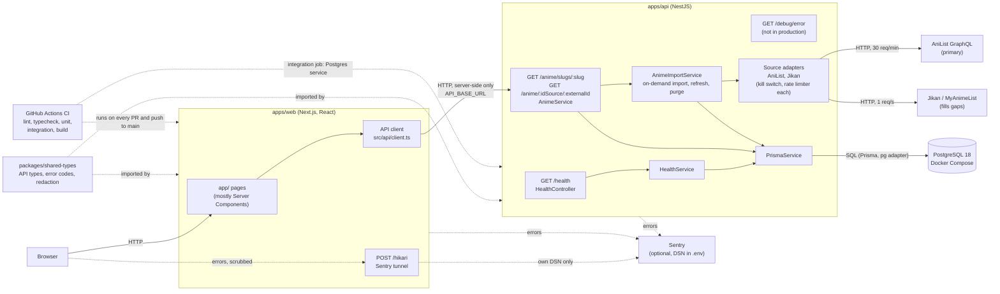

# Architecture

What exists in the code today (end of Phase 0). Planned parts are not drawn; they get added here when they ship. Keep this file in sync with the code: a change that adds a box or an arrow updates the diagram in the same PR.

## Pieces

- **apps/web**: Next.js App Router. Pages are Server Components, except the error boundaries and the client-error debug button; the browser never calls the API. Every network call goes through `src/api/client.ts` (`apiClient()`), which applies timeouts and returns expected failures as an `ApiResult` instead of throwing; ESLint blocks raw `fetch` elsewhere, except in the Sentry tunnel `src/observability/sentry-tunnel.ts` ([ADR 0003](decisions/0003-web-api-client.md) and its OTA-87 addendum). The home page (OTA-136) is a static hero and three catalog rows from `GET /anime/lists/:kind`, each streamed behind its own Suspense; there are also anime pages, info pages, error pages and debug pages for testing Sentry.
- **apps/api**: NestJS. Validated config from the repo-root `.env` (the API refuses to boot on a missing or invalid variable), one error envelope `{ "error": { "code", "message" } }` (except the 503 body of `/health`, a `HealthResponse`), request validation, `GET /health` (200, or 503 while Postgres is down), Swagger at `/docs` outside production ([ADR 0002](decisions/0002-api-validation-and-errors.md)). Logs are one JSON object per line with a `requestId` ([ADR 0004](decisions/0004-error-tracking-and-logging.md)).
- **Anime data** ([ADR 0006](decisions/0006-anime-data-sources.md) and its OTA-92 update): `GET /anime/:idSource/:externalId` (`anilist` or `myanimelist` id) serves the core anime from our database. An anime we do not have is imported on the request from AniList (one shared import per anime); Jikan fills MAL data in the background. Each source has an adapter, a kill switch (`ANIME_SOURCE_*_ENABLED`) and a rate limiter; each stored value keeps its source and fetch time (`anime_source_snapshot`, one row per anime and source), merged at read time. Stale data is served at once and refreshed in the background (daily while airing, weekly otherwise); anime nobody opened for 30 days are purged daily. Adult entries are never stored. For the page header (OTA-97), the AniList snapshot also keeps the original creators ("Original Creator" / "Original Story" staff), favourites, AniList's all-time ranks by score and by popularity among anime of the same format, and the cover colour; these are AniList-only fields, never filled from MyAnimeList. "Original Character Design" counts as a creator only next to an "Original Story" credit (split writer/artist manga such as Death Note), not for light-novel illustrators.
- **Anime slugs** ([ADR 0007](decisions/0007-anime-slugs.md)): each AniList anime gets a permanent slug from its English title (romaji as fallback), claimed when its AniList snapshot is stored. `anime_identity` (canonical slug, `removed_at`) and `anime_slug` (every slug ever claimed) are keyed on the AniList id and have no link to `anime`, so the purge never breaks a URL; an anime deleted for being adult is never imported again. `imported_at` marks identities an anime was ever stored for; never-imported list claims can be released by hand (ADR 0016, OTA-192 addendum). `GET /anime/slugs/:slug` serves the anime for its canonical slug and answers `{ kind: "redirect", canonicalSlug }` for any other slug of it (alias, former canonical, other letter case); the web app turns that into a 301 (OTA-97). Every anime response carries `canonicalSlug`, null until the anime has an AniList identity.
- **Anime pages** (OTA-97, in progress): `apps/web/app/anime/[slug]/` holds the layout (header inside Suspense, so a first-visit import streams) and one route per tab, each tab's content behind its own Suspense. `apps/web/proxy.ts` decides redirects and 404s before rendering, from `GET /anime/slugs/:slug/resolve` (database only): with Partial Prefetching a page cannot change its HTTP status once the App Shell is sent. The design tokens and component styles (`docs/design/anime-page/`) are the web app's global styles; the theme follows the visitor's system setting. The header (`header.tsx`) renders from one pure view model, `headerFacts()` in `src/anime/header-facts.ts`, which drops any value AniList lacks (never a 0 or `#null`); the sticky bar (`sticky-bar.tsx`, a client component) reuses it and appears through an IntersectionObserver on the header, its progress line a CSS scroll timeline. The page accent comes from AniList's cover colour: `accentPalette()` in `src/anime/accent.ts` derives `--accent-ink` per theme at 4.5:1 and `--on-accent`, emitted as a small `<style>` for `.anime-page` because the tabs render outside the header's Suspense boundary. Status and season chip colours are tokens; `app/styles/tokens.test.ts` checks their contrast on the chip's tinted fill in both themes. Images are shown from the source CDN as-is (`images.unoptimized`): never fetched, resized or stored by the web server.
- **Season selector** (OTA-97): the header loads `GET /anime/slugs/:slug/franchise` beside the anime and renders the main line as a disclosure of links in the hero (not the sticky bar), each opening the same tab on that season; a season not imported yet (`imported` not true; a claimed slug is not enough) links through `animeLink()` (ADR 0018) to `/anime/anilist/[id]/[[...tab]]`, which imports it and redirects to its canonical slug on the same tab (OTA-172).
- **Anime search** ([ADR 0016](decisions/0016-anime-search.md), OTA-98, slice 1): `GET /anime/search?q=&page=&pageSize=` ranks the stored titles (English, romaji, native, synonyms of every enabled source) with `pg_trgm` `word_similarity` over `anime_search_normalize()`, one SQL function shared by the stored titles and the query. Exact title first, then similarity, popularity and id; each hit says which title matched. `AnimeSearchService` runs the ranking (`anime-search.query.ts`), then loads the page's anime with one query, merges them with `mergeAnime` (kill switches apply) and reads slugs from `anime_identity`. It never calls a source and never updates `last_viewed_at`. Slice 1 scores the snapshots on the fly (fine up to a few hundred anime); slice 2 moves the titles into an indexed table before any web page calls the endpoint.
- **Franchise walk** ([ADR 0008](decisions/0008-franchise-chain.md), OTA-95): `FranchiseWalker` walks SEQUEL/PREQUEL edges from one AniList anime in the background, one batched AniList request per level (free slot only, so page requests never wait), and stores each entry's summary and edges in `anime_relation_node` (no link to `anime`; purged 30 days after last use). `anime_franchise_override` holds manual fixes (`SEASON`, `RELATED`, `BOUNDARY`, label), shipped as reviewed data migrations. `buildFranchise` (`franchise-view.ts`, pure) computes the main line, its labels and the Related groups from the stored rows at read time; `GET /anime/slugs/:slug/franchise` serves it from stored rows only and queues a walk when rows are missing or stale; `SourceBackoff` keeps an entry AniList answers badly (no `isAdult`, or left out of a relations answer) from costing a request per view (it waits 1 h, 6 h, 1 d, then a week; a franchise missing an id on an early step answers `partial`).
- **Catalog lists** ([ADR 0016](decisions/0016-catalog-lists.md), OTA-135 and OTA-177: `trending`, `top`, `upcoming`, `airing`, `seasonal`): `GET /anime/lists/:kind?cursor=&limit=&genre=&season=&year=` (`genre` on every kind, one value of `ANIME_GENRES`; `season` and `year` for `seasonal` only, both or neither, neither is the current UTC season, echoed as `season: { season, year }`, null for other kinds) (limit 1 to 50, default 24; opaque cursor, at most 1,000 deep). `AnimeListService` reads one or two stored AniList result pages from `anime_list_page` (key list + page, up to 50 cards as JSON, no link to `anime`), serves a stale one at once and refreshes it in the background on a free limiter slot only; the key is `kind|season=S|year=Y|genre=G` built after defaults; a page we do not hold waits for one AniList call (else 503 `ANIME_SOURCES_UNAVAILABLE`), and every new source fetch, background refreshes included, takes a token from a global bucket (6, one back every 10 s; empty: 429 `ANIME_LIST_FETCH_LIMIT_REACHED`, stored pages unaffected; a block in its retry delay takes no token, and a token is given back when no request was sent). Fetches are shared per page in the process. Slugs are joined from `anime_identity` when served (null: the web links `/anime/anilist/:id`), removed anime are dropped. A page is fetched only when the stored page before it has a next page, a failed block is not asked again for 5 minutes, and `AnimePurgeScheduler` deletes pages older than 30 days. Listed anime claim slugs (OTA-190): after a page is stored, `AnimeSlugClaimService` gives each listed anime without an identity a canonical slug and its romaji alias from the page's titles, one transaction per anime, no `anime` row and no source call; only unfiltered lists and the current season claim (until OTA-189); a failed claim leaves the slug null until the next fetch.
- **PostgreSQL**: one container from `docker-compose.yml`, bound to 127.0.0.1, with a dev database and a test database. Prisma 7 owns the schema and migrations (`apps/api/prisma`); there are no tables yet.
- **packages/shared-types**: built to `dist/` and imported by both apps: the API response types (`HealthResponse`, `ApiError`), error codes and their type guards, and the redaction used before anything reaches a log or Sentry.
- **Sentry**: the API, the web server and the browser report errors when their DSN is set; with no DSN nothing is sent. Scrubbing runs before sending ([ADR 0004](decisions/0004-error-tracking-and-logging.md)). The browser sends to our own `/hikari` route, which forwards only envelopes for our DSN, so blockers of sentry.io do not drop them ([ADR 0003 addendum](decisions/0003-web-api-client.md)).
- **CI**: `.github/workflows/ci.yml`, five parallel jobs on every PR and push to main. The unit job has no database; the integration job gets a Postgres service and recreates the test database itself ([ADR 0005](decisions/0005-integration-tests-real-postgres.md)).
- **Deploy**: Railway runs the API and Postgres in production, Vercel the web app. See [docs/deploy.md](deploy.md) for Railway settings, rollback, backups and restore, and [docs/deploy-vercel.md](deploy-vercel.md) for Vercel.
- **PR screenshots** ([ADR 0013](decisions/0013-pr-screenshots.md), OTA-163): `.github/workflows/screenshots.yml` builds the API and web against a local replay of the recorded source fixtures (`scripts/screenshots/`), captures the routes in `routes.json` at 1440 px and 390 px, dark and light, and posts them in one sticky PR comment (`<!-- pr-screenshots -->`) when the PR changes a page. Only a crashed app fails the run.

## Decisions

- [Engineering charter](engineering-charter.md): how the project is built.
- [ADR 0001: Core stack](decisions/0001-core-stack.md)
- [ADR 0002: API validation, error envelope, health and Prisma wiring](decisions/0002-api-validation-and-errors.md)
- [ADR 0003: Web API client](decisions/0003-web-api-client.md)
- [ADR 0004: Error tracking and structured logging](decisions/0004-error-tracking-and-logging.md)
- [ADR 0005: Integration tests against a real PostgreSQL](decisions/0005-integration-tests-real-postgres.md)
- [ADR 0013: Screenshots of the real pages on every web PR](decisions/0013-pr-screenshots.md)
- [ADR 0015: Authentication](decisions/0015-authentication.md) (proposed, not built yet: sessions in Postgres, cookie on the web origin only, Brevo for email)
- [ADR 0016: Anime search](decisions/0016-anime-search.md) (accepted, slice 1 built: trigram matching with `pg_trgm`)
- [ADR template](decisions/0000-template.md)
