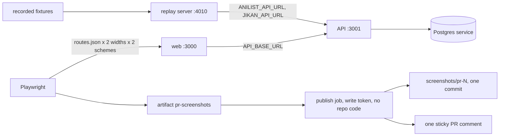

# 0013: Screenshots of the real pages on every web PR
Status: proposed (2026-11-11, OTA-163). Decided in an unattended run; accepted when Farouk merges the PR (protected paths).

## Context
Reviewing a UI PR today means pulling the branch or trusting the mockup. The autopilot's page report (skill step 7) shows mockups "until that job exists". We want the real pages, rendered by the real API and web builds, visible in the PR itself.

**Functional requirements**
1. A reviewer should be able to see every route listed in one file, at 1440 px and 390 px, dark and light, in one PR comment that each push updates.
2. The pages show data from the recorded fixtures only. A page without data shows its own empty or error state, and that is a valid screenshot.
3. The autopilot should be able to reuse the same images in its page report.

**Non-functional requirements (quantified)**
1. Capture job under 5 minutes wall-clock (target 4). Runaway guard: `timeout-minutes: 8`; the capture script stops itself after 90 s.
2. Zero requests from our servers to a live source API: both source base URLs point at `127.0.0.1`.
3. The job fails only when the app is broken: install, build or migration fails, API `/health` or web `/` does not answer within 30 s, or either is down after the capture. A failed screenshot, seed or publish step never fails the PR.
4. Storage is bounded: one commit of at most 8 routes x 4 images per open PR, deleted after the PR closes; artifact kept 14 days. No paid service, no secret.
5. Least privilege: PR code runs with `contents: read` only. The job with a write token runs no code from the repo. Fork and Dependabot PRs get the artifact, no comment.

**Consistency vs availability:** availability. A stale or missing comment is harmless, so everything after the health check is best effort and last writer wins (the ref and the comment). Nothing here may block a merge except a crashed app.

## Options
**Where the images live** (a comment can only embed an image that has a URL):

| Option | Verdict |
| --- | --- |
| **Orphan commit on `screenshots/pr-<n>`, linked by commit SHA** (chosen) | Free, no secret, `GITHUB_TOKEN` only. The branch is force-updated to a single commit, so size stays bounded. |
| One shared `screenshots` branch, append-only | Rejected: about 24 PNGs per push, never deleted. At 5 pushes a day that is roughly 1 GB a month in a repo every clone fetches. Squashing it instead needs a retry loop when two PRs publish at once. |
| Workflow artifact only | Needed anyway, but it is a zip behind a login: cannot be embedded. |
| External host (Vercel Blob, Imgur, S3) | Rejected: a new service and a secret in CI for something git already does. |
| GitHub Pages, comment attachments, data URIs | Pages would publish a site; attachments have no API; GitHub strips data URIs. |

**Where the data comes from:**

| Option | Verdict |
| --- | --- |
| **A local replay server behind `ANILIST_API_URL` / `JIKAN_API_URL`** (chosen) | No app code changes. These variables already exist, and the integration tests fake the sources the same way. Data enters through the real import, merge and slug code. |
| A fixture mode in the API (`ANIME_SOURCE=fixtures`) | Rejected: a test-only branch in production code, plus `.env.example`, for a seam we already have. |
| A committed SQL dump | Rejected: breaks on every migration. |

**Playwright:** not a dependency today. The job installs a pinned `playwright@1.63.0` outside the repo (`$RUNNER_TEMP`), the version preinstalled in Claude cloud sessions, so local and CI shots use the same Chromium. No `package.json` or lockfile change. Trade-off: no lockfile integrity for it, acceptable because that job has a read-only token and no secrets. When the first end-to-end test lands (ADR 0001), Playwright becomes a devDependency and the install step goes away.

## Decision

**Entities:** ScreenshotRoute (name, path), SeedAnime (MAL id), Viewport (1440x900, 390x844), ColorScheme (dark, light), Screenshot (route x viewport x scheme: PNG or failure reason), CaptureManifest, StickyComment.

**Interfaces** (no product API changes)
- `scripts/screenshots/routes.json`: `{ "seedMalIds": [52991, 21, 2963], "routes": [{ "name": "anime-overview", "path": "/anime/frieren-beyond-journeys-end" }] }`. The one file to edit. Max 8 routes. No signed-in routes yet.
- Replay server (`fake-sources.mjs`, port 4010): `POST /` answers the AniList queries (`{id}` or `{idMal}`: the core fixture, else the recorded 404; `{ids}`: the recorded walk nodes for those ids, unknown ids left out, as AniList does). `GET /v4/anime/:malId`: the Jikan fixture or 404.
- Capture (`capture.mjs`): seeds through `GET /anime/myanimelist/:id`, then writes `<name>-<width>-<scheme>.png`, `manifest.json` and `comment.md` (image base URL left as a placeholder).
- Image URL: `https://github.com/<repo>/raw/<commit sha>/<file>`. Pinned to a commit, so no stale cache; this form also works for signed-in viewers if the repo ever turns private (`raw.githubusercontent.com` links would 404 then: camo fetches anonymously).
- Comment: found by `<!-- pr-screenshots -->` on its first line and author `github-actions[bot]`; PATCH if found, POST otherwise.

**Data flow**

**Design, simplest first**
1. New workflow `.github/workflows/screenshots.yml`, `pull_request` with `paths` (`apps/web`, `apps/api`, `packages/shared-types`, `scripts/screenshots`, the workflow itself). `ci.yml` keeps its read-only token untouched.
2. Job `capture`: Postgres service, install, build, `pnpm db:migrate`, start replay, API and web, health check, seed, capture, health check again, upload artifact.
3. Job `publish` (same-repo PRs only): if the PR's diff touches `apps/web/app`, `apps/web/src` (not only tests) or the screenshot tooling, push the images and upsert the comment; then delete `screenshots/pr-*` branches whose PR is closed. Otherwise no comment.
4. Dark and light use Playwright's `colorScheme`. With no `ol-theme` cookie the site is on System and `tokens.css` follows `prefers-color-scheme`, which is what a first visitor sees.

**Deep dives (only the requirements above)**
- *Time (NFR 1).* Assumed, to be measured on this PR's own run: setup 35 s, build 80 s, Chromium 35 s, migrate 5 s, start 8 s, seed 25 s, capture 45 s, upload 5 s: about 4 min. The AniList limiter allows one request per 2 s, so the seed is three anime with short walks (Frieren 3 requests, One Piece 2, Minami-ke 1), capped at 25 s. If over budget: cache `~/.cache/ms-playwright` first, then install Chromium while building.
- *Failure policy (NFR 3).* The capture script always exits 0 and records each failure in the manifest; the comment prints it as text. Publish steps are `continue-on-error`. The second health check exists because a page that kills the server would otherwise look like 20 harmless screenshot timeouts.
- *No live source (NFR 2).* The API never sees the real base URLs. Cover and banner images are still loaded by the headless browser from the CDNs the fixtures name, exactly as a visitor's browser does (OTA-97); the script waits at most 5 s for them.
- *Privilege and storage (NFR 4, 5).* The comment body is built in the read-only job and only has its image base URL substituted in the write job. The orphan commit carries `apps/web/vercel.json` with `git.deploymentEnabled: false`, so Vercel does not try to deploy a branch that has no app.

## Consequences
- **Too simple, accepted:** "changes a page" is decided by path, so an API-only PR that changes what a page shows gets the artifact but no comment. A comment is not removed if later pushes stop touching pages. Shots are not pixel-stable (countdown, live covers), which is fine because nothing diffs them.
- **Too complicated, avoided:** visual regression baselines, an external image host, a fixture mode in the API, the Playwright test runner, a third-party sticky-comment action, a Chromium cache before it is measured.
- The replay server is a second fake of the same fixtures next to the one in `anime.integration.spec.ts`. If the queries change, both must follow; the script test catches the replay side.
- The `screenshots/pr-<n>` branches are bot-owned and force-updated. That is the one place a forced update is allowed; main and work branches keep the rule.
- `autopilot-merge.yml` must also listen to this workflow, or a PR whose CI finishes first is never retried.
- If Vercel still reacts to these branches, switch the ref to `refs/screenshots/pr-<n>` (not a branch: no deploy, not cloned). The URLs do not change because they use the commit SHA.

## Learnings
Job time is measured on this PR's first run; the figures above are assumptions until then. Closed PRs' branches are pruned by the next run's publish job, not on close.
