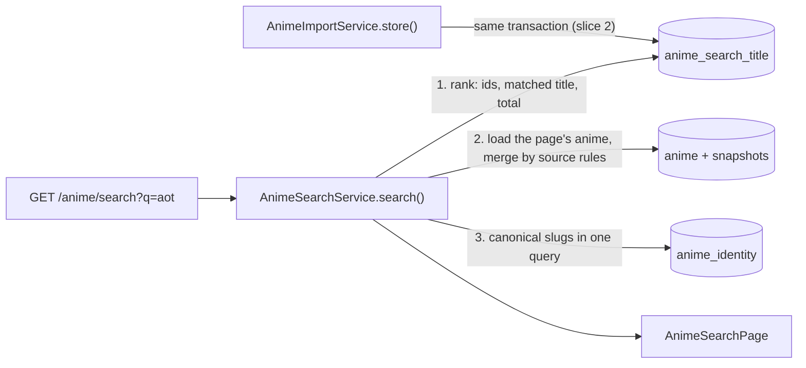

# 0015: Anime search: trigram matching on stored titles

Status: accepted (2026-11-12, OTA-98)

## Context

OTA-98 builds search: a fan types whatever they call a show (English, romaji, Japanese, "AoT") in the header box or on `/search` and lands on it. The design is in `docs/design/search/motion.md`. This record decides how the API matches and ranks titles in our own database. The AniList fallback, the web pages and the unknown-slug flow are later slices of the same ticket (list at the end) and are only sketched here.

Constraints that shape the decision:

- Titles live in `anime_source_snapshot`, one row per anime and source: `title_english`, `title_romaji`, `title_native` and a `synonyms` array (ADR 0006). A source that is switched off must disappear from results without deleting data.
- The database is a cache of what visitors opened, purged after 30 days without a view (ADR 0006). It can never hold more than AniList's whole anime catalogue. Assumption used for sizing: about 20,000 anime, so about 120,000 titles at 6 per anime. A realistic first year is a few thousand anime.
- Stack rule: PostgreSQL only; no search engine, Redis or queue before a measured need.
- ADR 0007 left abbreviations ("AoT", "SnK") to search: they are AniList synonyms, not slugs.

### Requirements

Functional:

1. A visitor can search anime by English, romaji or native title or by synonym, ignoring letter case, accents and punctuation, and still find the anime with a typo ("atack on titn").
2. Every hit says which title matched, so the card can show "Also known as AoT" when it was not the displayed title.
3. Results are ranked best match first and paginated: 24 per page by default, 50 at most.

Non-functional, with numbers:

1. Latency: the ranking query takes at most 50 ms at p95 with 5,000 cached anime, and at most 150 ms at the 20,000 ceiling. The header popover sends one request per 250 ms pause in typing, so this is the budget that matters.
2. Relevance: a table of at least 20 real queries (abbreviations, typos, punctuation, accents, Japanese, very short queries) runs against a real PostgreSQL in CI, and every row returns the expected anime first.
3. Availability: local search makes zero calls to a source. It answers when AniList is down, rate-limited or switched off.
4. Freshness: an anime is searchable as soon as the import that stored it commits. A title edited on AniList follows the normal snapshot refresh (daily while airing, 7 days otherwise).
5. Bounded cost: query text at most 100 characters, page at most 100, page size at most 50. Indexing adds one delete and one insert of about 6 small rows per stored snapshot, and about 23 MB of storage at the 20,000 ceiling.

Consistency or availability: **availability**. A stale or missing search result costs one extra click and is never harmful, so search must never wait for, or fail because of, a source. Inside our own database the search titles are written in the same transaction as the snapshot, which costs nothing and avoids a second kind of staleness.

## Options

All timings below were measured for this record on a 2 vCPU cloud sandbox with PostgreSQL 16.15: 13 real anime plus a synthetic catalogue of syllable-built titles, 6 titles per anime, median of 7 runs. Production runs PostgreSQL 18 on other hardware, so read them as orders of magnitude.

1. **PostgreSQL full-text search (`tsvector`, GIN).** Rejected. It matches whole words after language-specific stemming, which suits prose and not proper nouns in three scripts. It has no typo tolerance at all, so "did you mean" would need `pg_trgm` anyway and we would run two mechanisms. Japanese titles have no spaces, so the default parser gives one token per title.
2. **Trigram matching computed on the fly from `anime_source_snapshot`, no new table, no index.** The simplest version, and the one slice 1 ships. Measured about 1 to 3 s per query at 20,000 anime, because every query normalises and scores all 120,000 titles. The cost grows with the number of titles, so by extrapolation (not measured) it passes the 50 ms budget only up to a few hundred anime. It cannot be the final design.
3. **Trigram GIN index on an expression over the snapshot row (all titles joined into one string), no new table.** Rejected. Appealing because PostgreSQL would keep it in sync with no application code. Measured 3 to 90 ms for ordinary queries but 1.1 to 2 s for short or common ones ("no", "ka", "k", "進撃"): the index can only say "this anime has a matching word somewhere", so thousands of rows come back and each title must still be normalised and scored. Prisma cannot describe an expression index either.
4. **Trigram GIN index on a table of stored, normalised titles.** Chosen, see below.
5. **A search engine (Meilisearch, Typesense, Elasticsearch).** Rejected: a second service to host, pay for and keep in sync, for at most 120,000 short strings that option 4 serves in milliseconds.

Not built, noted for later: a hand-maintained alias table for abbreviations AniList lacks. AniList's synonyms already carry "AoT" and "JJK"; add the table only when the ranking test table shows a miss that matters.

## Decision

**Trigram matching (`pg_trgm`) with `word_similarity`, on a table of normalised titles with a GIN index.** Built in two steps so each pull request stays small and the second one is a measured change: slice 1 ships the endpoint on option 2 (titles read from the snapshots), slice 2 adds the table and index and changes only where the query reads titles from. The ranking test table from slice 1 proves the swap changes no result. Slice 2 must merge before any web page calls the endpoint.

### Core entities

- `AnimeSourceSnapshot` (exists): the source of every title.
- `AnimeSearchTitle` (new, slice 2): one row per distinct normalised title of one anime in one source.
- `AnimeSearchHit` and `AnimeSearchPage` (new, `packages/shared-types`): the response.

### API

`GET /anime/search?q=&page=&pageSize=`. `q` is required, 1 to 100 characters after trimming and NFKD decomposition; NUL characters count as spaces. `page` is 1 to 100, default 1. `pageSize` is 1 to 50, default 24. Anything else is a 400 with the usual error envelope (ADR 0002). A query with no letters or digits ("!!!") is a valid request that returns an empty page. Later slices add `format`, `season`, `year`, `genre`, `status`, `sort` and `exact` as optional query parameters, and a `correction` field on the page.

```ts
export const ANIME_TITLE_KINDS = ['english', 'romaji', 'native', 'synonym'] as const;
export type AnimeTitleKind = (typeof ANIME_TITLE_KINDS)[number];

export interface AnimeSearchHit {
  /** Canonical slug (ADR 0007); null when the anime has no AniList identity: link by `ref`. */
  readonly slug: string | null;
  /** The AniList id when visible, else the MyAnimeList id. */
  readonly ref: { readonly source: AnimeIdSource; readonly id: string };
  /** English, else romaji, else native, else the matched title. */
  readonly title: string;
  /** Always present. The card shows "Also known as" when `text` differs from `title`. */
  readonly matchedTitle: { readonly kind: AnimeTitleKind; readonly text: string };
  readonly format: AnimeFormat | null;
  readonly episodes: number | null;
  readonly season: AnimeSeason | null;
  readonly seasonYear: number | null;
  readonly startYear: number | null;
  readonly coverImageUrl: string | null;
  readonly coverColor: string | null;
  /** The first visible source's score, with its label (scores are never mixed, ADR 0006). */
  readonly score: Pick<AnimeScore, 'source' | 'score' | 'scale'> | null;
}

export interface AnimeSearchPage {
  readonly hits: readonly AnimeSearchHit[];
  readonly page: number;
  readonly pageSize: number;
  /** Anime matching the query, across all pages. */
  readonly total: number;
}
```

The hit names an anime by `slug` and `ref`, not by our internal id, so a hit that comes from AniList and is not imported yet (a later slice) has the same shape.

### Data flow



Three database queries per request and no source call. Step 2 reuses `mergeAnime`, so the kill switches and the "one primary source per field" rule stay in one place. Being listed in results is not a view: search never updates `last_viewed_at`, otherwise the 30-day purge would stop working.

### Design

**Normalisation** is one SQL function, used on both the stored title and the query, so the two can never disagree and there is no TypeScript copy to keep in step:

```sql
CREATE FUNCTION anime_search_normalize(value text) RETURNS text
LANGUAGE sql IMMUTABLE PARALLEL SAFE RETURNS NULL ON NULL INPUT
RETURN btrim(regexp_replace(
  translate(
    regexp_replace(lower(normalize(value, NFKD)), '[\u0300-\u036f\u0027\u2018\u2019\u02bc]', '', 'g'),
    U&'\00D7', 'x'),
  '[\x01-\x2f\x3a-\x40\x5b-\x60\x7b-\x7f]+', ' ', 'g'));
```

In words: Unicode compatibility decomposition and lowercase; accents and apostrophes (U+0027, U+2018, U+2019, U+02BC) deleted; `×` becomes `x`; every run of ASCII punctuation or whitespace becomes one space. Examples: `Re:ZERO -Starting Life-` gives `re zero starting life`, `HUNTER×HUNTER (2011)` gives `hunterxhunter 2011`, `JoJo's` gives `jojos`, `Pokémon` gives `pokemon`, full-width `８６－` gives `86`, `!!!` gives an empty string. The rules follow ADR 0007's slug rules where they overlap. Because `%`, `_` and `\` are removed, a normalised query is always safe inside a pattern.

**Matching.** A title matches when `anime_search_normalize(q) <% normalized`: the `pg_trgm` word-similarity operator, at its default threshold of 0.6. It compares the query with the best-matching stretch of the title, so one word of a long title, a word prefix and a small typo all pass, and a query of one or two characters only matches a whole word (searching "k" finds the anime "K", not every title containing a k). The default threshold is used on purpose: the operator can use the index without any per-session setting.

**Ranking**, in order: an exact match of the whole normalised title first; then `word_similarity` descending; then popularity descending (the `members` value of the first enabled source in priority order); then the anime id, so pages are stable. When several titles of one anime match, the hit reports the best one, and at equal score English wins over romaji, native and synonym, so no "Also known as" line appears when the displayed title matched just as well.

Slice 1 query, verified against the real schema on PostgreSQL 16. `$1` is the raw query, `$2` the enabled sources in priority order, `$3` and `$4` limit and offset:

```sql
WITH scored AS (
  SELECT x.anime_id, x.source, x.kind, x.title,
         x.normalized = anime_search_normalize($1) AS exact,
         word_similarity(anime_search_normalize($1), x.normalized) AS score
  FROM (
    SELECT s.anime_id, s.source, t.kind, t.title, anime_search_normalize(t.title) AS normalized
    FROM anime_source_snapshot s
    CROSS JOIN LATERAL (
      VALUES (1, s.title_english), (2, s.title_romaji), (3, s.title_native)
      UNION ALL SELECT 4, unnest(s.synonyms)
    ) AS t(kind, title)
    WHERE s.source = ANY($2) AND t.title IS NOT NULL
  ) x
  WHERE anime_search_normalize($1) <% x.normalized
),
best AS (
  SELECT DISTINCT ON (anime_id) anime_id, kind, title, exact, score
  FROM scored
  ORDER BY anime_id, exact DESC, score DESC, kind, array_position($2, source)
),
page AS (
  SELECT best.*, popularity.members
  FROM best
  LEFT JOIN LATERAL (
    SELECT s.members FROM anime_source_snapshot s
    WHERE s.anime_id = best.anime_id AND s.source = ANY($2)
    ORDER BY array_position($2, s.source) LIMIT 1
  ) popularity ON true
  ORDER BY exact DESC, score DESC, popularity.members DESC NULLS LAST, anime_id
  LIMIT $3 OFFSET $4
)
SELECT totals.total::int, page.anime_id, page.kind, page.title
FROM (SELECT count(*) AS total FROM best) totals
LEFT JOIN page ON true
ORDER BY page.exact DESC, page.score DESC, page.members DESC NULLS LAST, page.anime_id;
```

The left join from `totals` means a page past the end returns one row with the right `total` and no anime, instead of no row. The normalised query is written inline rather than joined from a one-row subquery: with the join the planner misjudged the filter on small tables and scanned them.

**Slice 2** replaces the inner `x` subquery with `anime_search_title` and adds:

```sql
CREATE TYPE "anime_title_kind" AS ENUM ('ENGLISH', 'ROMAJI', 'NATIVE', 'SYNONYM');
CREATE TABLE "anime_search_title" (
    "anime_id" UUID NOT NULL,
    "source" "anime_data_source" NOT NULL,
    "normalized" TEXT NOT NULL,
    "kind" "anime_title_kind" NOT NULL,
    "title" TEXT NOT NULL,
    CONSTRAINT "anime_search_title_pkey" PRIMARY KEY ("anime_id","source","normalized")
);
CREATE INDEX "anime_search_title_normalized_idx" ON "anime_search_title" USING GIN ("normalized" gin_trgm_ops);
ALTER TABLE "anime_search_title" ADD CONSTRAINT "anime_search_title_anime_id_source_fkey"
  FOREIGN KEY ("anime_id", "source") REFERENCES "anime_source_snapshot"("anime_id", "source")
  ON DELETE CASCADE ON UPDATE CASCADE;
```

- The primary key includes `normalized`, so titles that normalise to the same text ("K" in English, romaji and native) are one row, keeping the best kind. Titles that normalise to nothing are not stored.
- The foreign key points at the snapshot with cascade, so the purge, the adult-content delete and takedowns remove search titles with no extra code.
- `store()` rewrites the titles of the snapshot it just upserted, in the same transaction: one `DELETE` for that anime and source, then one `INSERT ... SELECT` that reads the titles back from the snapshot row and normalises them in SQL. The migration backfills existing snapshots with the same `INSERT ... SELECT` without the filter. Two concurrent imports of one anime queue on the snapshot row's lock before they reach the titles, so they cannot collide.
- An explicit write in the service was preferred to a database trigger: a trigger cannot be forgotten, but nobody reading the import code would know it exists.

### Deep dives, one per non-functional requirement

**Latency.** Same data set and machine as in Options.

| Cached anime (titles) | Ordinary queries ("aot", "atack on titn", "shingeki", a 6-word query) | Worst case: fragments shared by thousands of titles ("sho", "ka", "no") |
| --- | --- | --- |
| 2,000 (11,000) | 0.4 to 1.3 ms | 8 ms |
| 5,000 (29,000) | 1 to 3 ms | 18 to 24 ms |
| 20,000 (119,000) | 0.8 to 5 ms | 78 to 89 ms |

Both rows of requirement 1 hold. At 20,000 anime the table is 10 MB, the GIN index 6 MB and the primary key 6.4 MB. The worst case is not the index but scoring and sorting thousands of true matches; if it ever matters, cap the candidates before sorting. No result cache: an indexed lookup of a few milliseconds does not need one.

**Relevance.** The ranking table is an integration test on real PostgreSQL (ADR 0005), seeded with real titles and synonyms as AniList lists them. Checked by hand while writing this record: "aot" and "AoT" return Attack on Titan first on its synonym, then Season 2 on "AoT S2"; "jjk", "re zero", "re:zero", "rezero", "hunter x hunter", "hunterxhunter", "jojos", "jojo", "86", "k", "pokemon", "shingeki", "進撃", "atack on titn" and "shingeki no kyojn" each return the expected anime first. "freiren" scores 0.33 against "frieren", below 0.6, and returns nothing: that is the case the designed "Showing results for frieren" notice covers. Slice 3 handles it with a second query at a lower threshold (about 0.3), run only when the first returns nothing, no filter is on and `exact=1` is absent.

**Availability.** The request path contains no adapter, limiter or HTTP call. The AniList fallback (slice 4) is added beside it, never in front of it: local hits are computed first and returned even when the fallback is out of budget, rate-limited or failing.

**Freshness.** In slice 1 the query reads the snapshots themselves, so there is nothing to keep in sync. In slice 2 the titles are written in the snapshot's transaction, so a reader sees both or neither.

**Bounded cost.** Offset pagination with a total count is enough here: the result set of one query is bounded by the catalogue, and `page` is capped at 100. The query text is capped at 100 characters after NFKD decomposition (one character such as U+FDFA expands to 18, so the raw length alone does not bound the work; a measured 100 of them took about 39 s at 20,000 anime), a query with no letter or digit skips the scan, and the ranking transaction runs with a 2 s `statement_timeout`. A timeout is not mapped to a 503 yet: it surfaces as the default 500.

## Consequences

Too simple, on purpose, and what would make us revisit:

- **Slice 1 alone does not meet the latency requirement** beyond a few hundred anime. Accepted because nothing calls the endpoint until slice 2 has merged.
- **No rate limit on a public endpoint that runs a database query.** The caps above bound one request, not the number of requests. This belongs with the API guard in OTA-173 and must be settled before launch.
- **Japanese substrings from the middle of a title are not found locally.** "進撃" finds 進撃の巨人 because it starts the title; "巨人" does not, because Japanese has no spaces for word matching to use. The AniList fallback covers it. If that is not enough, add a `LIKE` branch as a separate `UNION ALL` arm guarded by "the query contains non-ASCII characters and is at least 3 characters long". Folding it into the same `WHERE` with `OR` was measured: short patterns made PostgreSQL walk the whole index (0.6 to 1.3 s).
- **Trigrams of non-Latin text depend on the database's character classification.** With `lc_ctype = C`, `pg_trgm` drops every non-ASCII letter and Japanese search silently returns nothing. The local PostgreSQL 16 (C.UTF-8) and the `postgres:18` image used in CI are fine. Check Railway once before launch: `SELECT show_trgm('進撃')` must not be empty. The "進撃" row of the ranking table guards CI.
- **Abbreviations exist only if AniList lists them as synonyms.** No alias table until a real miss shows up.
- **Popularity compares AniList's count with MyAnimeList's** for the rare anime that only has a Jikan snapshot; MyAnimeList's numbers are larger, so such an anime can rank a little high among equal scores.
- **The match threshold is the database default** (`pg_trgm.word_similarity_threshold`, 0.6). Changing that setting on the server changes search results; the ranking table would catch it.
- **A hit drops the per-field source labels** that `AnimeDetails` carries; only the score keeps its source. `FranchiseEntry` already does the same for cards.

Too complicated, and therefore not built: full-text beside trigram, per-kind weights, a blended relevance formula, a result cache, cursor pagination, an alias table, a search engine. The only machinery added is one table with one index, and it is added in slice 2 because the measurement above requires it.

Operational notes:

- `pg_trgm` is a trusted extension: `CREATE EXTENSION IF NOT EXISTS pg_trgm` in the migration works for the database owner on PostgreSQL 13 and later. The integration template database gets it from the migration, and every per-file clone inherits it.
- Changing `anime_search_normalize` later needs a new migration that replaces the function and rewrites `anime_search_title` in the same transaction.
- The slice 2 migration is written by hand to match what Prisma generates for the model (cloud sessions cannot run the Prisma schema engine). Before merging it, run `prisma migrate dev --create-only` once on a machine that can and confirm the diff is empty, as ADR 0007 did for its CHECK constraint.

Slices of OTA-98:

1. This record; migration with `pg_trgm` and `anime_search_normalize`; `GET /anime/search` over snapshot titles; shared types; ranking test table.
2. `anime_search_title`, GIN index, write in `store()`, backfill; the query reads the table; before and after timings in the worklog.
3. "Did you mean" (`correction`, `exact=1`), filters and sort.
4. AniList fallback through the adapter: its own small budget inside the AniList limiter, misses cached for 1 hour, local results only when the budget is spent; import on click.
5. Web: instant suggestions in the header box (3 characters minimum, 250 ms debounce, 8 results).
6. Web: `/search` results page. It reuses the OTA-154 browse template, which is designed but not built in `apps/web` yet.
7. Unknown slug: one AniList search with the slug as words, import and redirect on an exact slug match, otherwise the 404 page with candidates.

## Learnings

- Measuring before choosing overturned the first plan twice. The no-table scan looked fine by arithmetic ("120,000 short strings") and took seconds, because normalising and scoring cost about 10 to 25 microseconds per title. The expression index looked like the cheapest fix and fell over on exactly the short queries a suggestion box sends.
