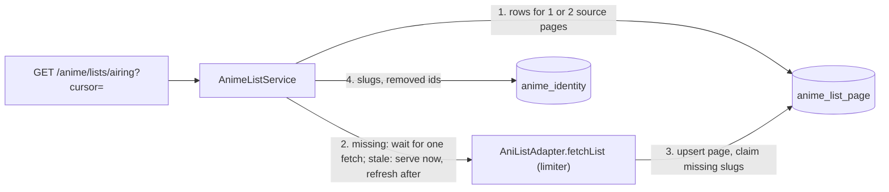

# 0016: Catalog lists: AniList result pages cached in Postgres

Status: accepted (2026-11-12, OTA-135)

## Context

OTA-135 adds `GET /anime/lists/:kind` for the Home rows (OTA-136) and the Seasonal, Rankings and Discover pages (OTA-137). The old site ran these AniList queries from every visitor's browser, about 7 per Discover load (PARITY.md). Constraints: AniList allows 30 requests per minute for the whole site and forbids mass collection (ADR 0006); an `anime` row is a disposable cache of what visitors opened, while a slug is permanent and keyed on the AniList id (ADR 0007); PostgreSQL only, no Redis, queue or scheduler service.

### Requirements

Functional:

1. A visitor can browse the `trending`, `airing`, `upcoming`, `top` and `seasonal` (season and year) lists, optionally narrowed to one genre.
2. Every entry carries what the approved card renders (`docs/design/browse/motion.md`) and a link target, including for anime we never imported.
3. A list is read forward with a cursor, at most 50 entries per request.

Non-functional, with numbers:

1. Latency: a page we hold, fresh or stale, is answered from PostgreSQL alone in at most 3 primary-key queries and zero source calls (target p95 50 ms; the integration test asserts the zero).
2. Quota: at most 1 AniList request per list and block of 50 entries per TTL, never one per anime. The three Home rows cost 6 requests a day out of 43,200.
3. Availability: with AniList down, every page fetched in the last 30 days still answers 200, marked `stale`.
4. Freshness: trending 1 h, airing 6 h, upcoming, top and seasonal 24 h.
5. Bounded cost: at most 1,000 entries deep per list, about 20 KB per stored page, pages not refreshed for 30 days deleted.

Consistency or availability: **availability**. A list that is an hour old, or shows an anime twice across two pages, harms nobody; a Home page waiting on AniList does.

## Options

1. **One row per AniList result page, entries as JSON, keyed by list and page number.** Chosen: the smallest thing that gives TTL, stale fallback and one request per page.
2. **Stub `anime` rows holding a partial AniList snapshot, plus a membership table.** Rejected: the anime page would serve a half-filled snapshot as if complete, so the model needs a "partial" state; a refresh could overwrite a full snapshot with a thin one; the 30-day purge (driven by views, and a listing is not a view) would delete stubs still listed; and every listed anime's data would sit in the anime cache unopened, which is what AniList's terms call hoarding.
3. **A normalised entry table (one row per list position).** Rejected for now: three times the code to page by position, which option 1 does with a slice. It becomes the right shape if lists must be filtered, sorted and counted in our database (see Consequences).
4. **Refresh on a timer.** Rejected: spends quota on lists nobody reads and needs a job runner; refresh-on-read needs neither.

## Decision

**Core entities:** `AnimeListPage` (new table), `AnimeListEntry` and `AnimeListPage` DTOs (shared-types), `AnimeIdentity` and `AnimeSlug` (exist, ADR 0007).

**API.** `GET /anime/lists/:kind?season=&year=&genre=&cursor=&limit=`, declared before `:idSource/:externalId` (both have two segments).

- `kind`: `trending | seasonal | top | upcoming | airing`. `limit`: 1 to 50, default 24.
- `season` (`WINTER | SPRING | SUMMER | FALL`) and `year` (1917 to next year) go together and only with `seasonal`; both omitted means the current season by the injected `Clock` (UTC; January to March is winter). The response echoes the season it served.
- `genre`: one of AniList's 18 non-adult genres (`ANIME_GENRES` in shared-types).
- Anything else, including a malformed cursor, is 400 `VALIDATION_ERROR`. AniList switched off, or a page we do not hold while AniList is down or its queue is full: 503 `ANIME_SOURCES_UNAVAILABLE`.
- Response: `{ kind, season, entries, nextCursor, freshness: 'fresh' | 'stale', fetchedAt }`. An entry: `anilistId`, `slug | null`, `titleEnglish`, `titleRomaji`, `coverImageUrl`, `coverColor`, `format`, `status`, `episodes`, `season`, `seasonYear`, `startDate`, `genres`, `members`, `score` (`{ source, score, scale }`, so the score keeps its source label, ADR 0006).

**Lists** (one AniList `Page` query, `type: ANIME`, `isAdult: false`, `perPage: 50`; arguments per AniList's docs and the old site's queries, not called from this session, where graphql.anilist.co is blocked):

| Kind | AniList filter and sort | TTL |
| --- | --- | --- |
| `trending` | sort `TRENDING_DESC, POPULARITY_DESC` | 1 h |
| `airing` | status `RELEASING`, sort `POPULARITY_DESC` | 6 h |
| `upcoming` | status `NOT_YET_RELEASED`, sort `POPULARITY_DESC` | 24 h |
| `top` | sort `SCORE_DESC, POPULARITY_DESC` | 24 h |
| `seasonal` | `season`, `seasonYear`, sort `POPULARITY_DESC` | 24 h |

Home's "Trending now" row calls `airing` (owner decision on OTA-136); `trending` stays for Discover.

**Cache table** `anime_list_page`: `list_key` text, `page` int (AniList page, from 1), `fetched_at`, `has_next_page`, `entries` jsonb; primary key `(list_key, page)`, no other index (a few hundred rows, read by key). `list_key` is built by one pure function, e.g. `airing`, `top|genre=Fantasy`, `seasonal|season=FALL|year=2026`: a text key instead of nullable columns, because a unique key over nullable columns needs `NULLS NOT DISTINCT`, which the Prisma schema has no syntax for as far as its docs show. No relation to `anime`. The TTL is derived from the request's kind, not stored. A row whose JSON no longer validates is treated as missing, so a later change of the entry shape needs no data migration.

**Data flow**

**Read path** (cache-aside, stale-while-revalidate):

- Fresh page: served. Stale page: served at once with `freshness: 'stale'`, and one background refresh starts, only when AniList is not cooling down and a request slot is free right now (as the franchise walker, ADR 0008), so it never delays an anime import. `stale` therefore means "older than its TTL", whether a refresh is running or AniList is down; the next request after a successful refresh is fresh.
- Missing page: the request waits for one AniList call with the normal visitor budget (4 s queue, 8 s timeout) and gets a 503 when it fails.
- Fetches are shared per `(list_key, page)` in the process, so a burst of requests costs one call.
- Kill switch off: 503 without reading the cache; rows are kept, so switching it back on restores them.

**Cursor.** Opaque `base64url("v1:" + offset)`, where offset is the position in the list, 0 to 999. A request reads `offset .. offset + limit - 1`, which touches at most two stored pages of 50. `nextCursor` is null when the last page read has no next page and nothing is left in it, or at the 1,000 cap. A page may hold fewer than `limit` entries (removed anime are dropped at read time): only a null cursor means the end. The cursor is not tied to a list or a refresh.

**Stubs and lazy import.** A list never creates `anime` rows and never calls AniList per anime. After storing a page, the service claims a slug for every listed AniList id that has no `anime_identity` yet, from the title, year and format in the entry, with the existing ADR 0007 rules (one small transaction per anime, retried on a lost race; a failure is logged and the entry keeps `slug: null`, which the web links through `/anime/anilist/:id`). An identity with slugs and no `anime` row is exactly the state of a purged anime, which `GET /anime/slugs/:slug` already imports on first open: that click is the lazy import. Slugs are joined from `anime_identity` at read time, never stored in the page, so a moved canonical or a removal shows at once. This amends ADR 0007: a slug can now be claimed before the anime is imported; an identity that already exists is never touched by a list. Claim order is list order, so the more popular of two same-title anime gets the bare slug.

**Adult and removed.** The query filters `isAdult: false` and the mapper drops any entry not explicitly `isAdult: false`; entries whose identity has `removed_at` are dropped when serving.

**Purge.** The daily purge deletes pages with `fetched_at` older than 30 days. A page still being read is refreshed long before, so no "last read" column and no write on read.

### Deep dives

- **Latency.** Warm path: up to 2 rows by primary key and one `anilist_id IN (≤ 50)` on `anime_identity`. Cold path: one AniList call (worst case 12 s, then 503) and up to 50 slug claims, once per anime ever.
- **Quota.** Home: airing 4 a day, seasonal 1, top 1. Each further list, genre or block of 50 costs one request per TTL only while someone reads it. Everything except seasonal at once (4 kinds × 19 genre choices × 20 pages, each read every TTL) would be about 11,400 a day, 26% of the budget, four fifths of it `trending`.
- **Availability.** Stale pages never expire on read; only the 30-day purge removes them. A refresh that fails starts the limiter's existing cool-down, during which no refresh is tried.
- **Bounded cost.** Realistic: under 300 rows, about 6 MB. Identities grow by one row plus about two slugs per listed anime, at most AniList's catalogue (about 20,000), and hold no AniList data beyond the slug.

## Consequences

Too simple, on purpose:

- **A public endpoint can spend AniList quota.** Each unseen key costs one request; the validated key space is about 8,500 lists (19 genre choices × about 440 seasons, plus the four other kinds) of up to 20 pages each, enough for a crawler to starve anime imports for hours and store several hundred MB. Belongs to the API guard (OTA-173) and must be settled before launch.
- **A cold start can fail a row.** More than three unseen lists requested together overflow the 4 s queue and the rest get a 503 once. No warm-up job is built: the cache survives deploys.
- **Pages of one list are fetched at different times**, so an anime can appear twice or be skipped between pages when the order moves. The web de-duplicates by `anilistId`.
- **One process.** Sharing fetches in memory means two API instances could each refresh a page; Railway runs one.
- **OTA-137 needs more than this ticket specifies.** The browse design expects multi-value format, genre and status filters (OR within a filter), a sort toggle, a year filter, a server-side total and a global rank, plus "recently completed" and "latest episodes". None is in OTA-135's acceptance criteria and none is built. More filters fit as more key parts and AniList arguments, but an exact total and OR across genres are not known to exist on AniList's side; that needs its own decision before OTA-137, and is where option 3 would be reconsidered.

Too complicated, and therefore not built: stub anime rows, a normalised entry table, a refresh scheduler or warm-up, an in-memory layer in front of Postgres, HTTP caching headers, keyset cursors, totals.

Operational notes:

- The migration is written by hand to match Prisma's output (cloud sessions cannot run the schema engine): run `prisma migrate dev --create-only` once locally and confirm the diff is empty.
- List fixtures cannot be recorded from a cloud session either. Until the owner records them, they are hand-built from the fields of the recorded walk fixtures and marked as such in the fixtures README.

## Learnings
