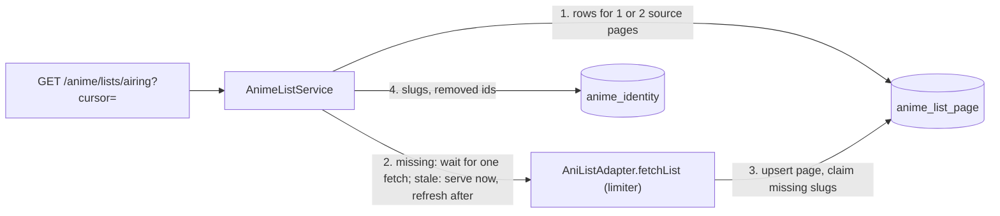

# 0016: Catalog lists: AniList result pages cached in Postgres

Status: accepted (2026-11-12, OTA-135)

## Context

OTA-135 adds `GET /anime/lists/:kind` for the Home rows (OTA-136) and the Seasonal, Rankings and Discover pages (OTA-137). The old site ran these AniList queries from every visitor's browser, about 7 per Discover load (PARITY.md). Constraints: AniList allows 30 requests per minute for the whole site and forbids mass collection (ADR 0006); an `anime` row is a disposable cache of what visitors opened, while a slug is permanent and keyed on the AniList id (ADR 0007); PostgreSQL only, no Redis, queue or scheduler service.

### Requirements

Functional:

1. A visitor can browse the `trending`, `airing`, `upcoming`, `top` and `seasonal` (season and year) lists, optionally narrowed to one genre.
2. Every entry carries what the approved card renders (`docs/design/browse/motion.md`) and a link target, including for anime we never imported.
3. A list is read forward with a cursor, at most 50 entries per request.

Non-functional, with numbers:

1. Latency: a page we hold, fresh or stale, is answered from PostgreSQL alone in at most 4 primary-key queries (3 before ADR 0018 added the `imported` lookup) and zero source calls (target p95 50 ms; the integration test asserts the zero).
2. Quota: at most 1 AniList request per list and block of 50 entries per TTL, never one per anime. The three Home rows cost 6 requests a day out of 43,200.
3. Availability: with AniList down, every page fetched in the last 30 days still answers 200, marked `stale`.
4. Freshness: trending 1 h, airing 6 h, upcoming, top and seasonal 24 h.
5. Bounded cost: at most 1,000 entries deep per list, about 20 KB per stored page, pages not refreshed for 30 days deleted.

Consistency or availability: **availability**. A list that is an hour old, or shows an anime twice across two pages, harms nobody; a Home page waiting on AniList does.

## Options

1. **One row per AniList result page, entries as JSON, keyed by list and page number.** Chosen: the smallest thing that gives TTL, stale fallback and one request per page.
2. **Stub `anime` rows holding a partial AniList snapshot, plus a membership table.** Rejected: the anime page would serve a half-filled snapshot as if complete, so the model needs a "partial" state; a refresh could overwrite a full snapshot with a thin one; the 30-day purge (driven by views, and a listing is not a view) would delete stubs still listed; and every listed anime's data would sit in the anime cache unopened, which is what AniList's terms call hoarding.
3. **A normalised entry table (one row per list position).** Rejected for now: three times the code to page by position, which option 1 does with a slice. It becomes the right shape if lists must be filtered, sorted and counted in our database (see Consequences).
4. **Refresh on a timer.** Rejected: spends quota on lists nobody reads and needs a job runner; refresh-on-read needs neither.

## Decision

**Core entities:** `AnimeListPage` (new table), `AnimeListEntry` and `AnimeListPage` DTOs (shared-types), `AnimeIdentity` and `AnimeSlug` (exist, ADR 0007).

**API.** `GET /anime/lists/:kind?season=&year=&genre=&cursor=&limit=`, declared before `:idSource/:externalId` (both have two segments).

- `kind`: `trending | seasonal | top | upcoming | airing`. `limit`: 1 to 50, default 24.
- `season` (`WINTER | SPRING | SUMMER | FALL`) and `year` (1917 to next year) go together and only with `seasonal`; both omitted means the current season by the injected `Clock` (UTC; January to March is winter). The response echoes the season it served.
- `genre`: one of AniList's 18 non-adult genres (`ANIME_GENRES` in shared-types).
- Anything else, including a malformed cursor, is 400 `VALIDATION_FAILED`. AniList switched off, or a page we do not hold while AniList is down or its queue is full: 503 `ANIME_SOURCES_UNAVAILABLE`.
- Response: `{ kind, season, entries, nextCursor, freshness: 'fresh' | 'stale', fetchedAt }`. An entry: `anilistId`, `slug | null`, `titleEnglish`, `titleRomaji`, `coverImageUrl`, `coverColor`, `format`, `status`, `episodes`, `season`, `seasonYear`, `startDate`, `genres`, `members`, `score` (`{ source, score, scale }`, so the score keeps its source label, ADR 0006).

**Lists** (one AniList `Page` query, `type: ANIME`, `isAdult: false`, `perPage: 50`; arguments per AniList's docs and the old site's queries, not called from this session, where graphql.anilist.co is blocked):

| Kind       | AniList filter and sort                           | TTL  |
| ---------- | ------------------------------------------------- | ---- |
| `trending` | sort `TRENDING_DESC, POPULARITY_DESC`             | 1 h  |
| `airing`   | status `RELEASING`, sort `POPULARITY_DESC`        | 6 h  |
| `upcoming` | status `NOT_YET_RELEASED`, sort `POPULARITY_DESC` | 24 h |
| `top`      | sort `SCORE_DESC, POPULARITY_DESC`                | 24 h |
| `seasonal` | `season`, `seasonYear`, sort `POPULARITY_DESC`    | 24 h |

Home's "Trending now" row calls `airing` (owner decision on OTA-136); `trending` stays for Discover.

**Cache table** `anime_list_page`: `list_key` text, `page` int (AniList page, from 1), `fetched_at`, `has_next_page`, `entries` jsonb; primary key `(list_key, page)`, no other index (a few hundred rows, read by key). `list_key` is built by one pure function, e.g. `airing`, `top|genre=Fantasy`, `seasonal|season=FALL|year=2026`: a text key instead of nullable columns, because a unique key over nullable columns needs `NULLS NOT DISTINCT`, which the Prisma schema has no syntax for as far as its docs show. No relation to `anime`. The TTL is derived from the request's kind, not stored. A row whose JSON no longer validates is treated as missing, so a later change of the entry shape needs no data migration.

**Data flow**



**Read path** (cache-aside, stale-while-revalidate):

- Fresh page: served. Stale page: served at once with `freshness: 'stale'`, and one background refresh starts, only when AniList is not cooling down and a request slot is free right now (as the franchise walker, ADR 0008), so it never delays an anime import. `stale` therefore means "older than its TTL", whether a refresh is running or AniList is down; the next request after a successful refresh is fresh.
- Missing page: the request waits for one AniList call with the normal visitor budget (4 s queue, 8 s timeout) and gets a 503 when it fails.
- Fetches are shared per `(list_key, page)` in the process, so a burst of requests costs one call.
- Kill switch off: 503 without reading the cache; rows are kept, so switching it back on restores them.

**Cursor.** Opaque `base64url("v1:" + offset)`, where offset is the position in the list, 0 to 999. A request reads `offset .. offset + limit - 1`, which touches at most two stored pages of 50. `nextCursor` is null when the last page read has no next page and nothing is left in it, or at the 1,000 cap. A page may hold fewer than `limit` entries (removed anime are dropped at read time): only a null cursor means the end. The cursor is not tied to a list or a refresh.

**Stubs and lazy import.** A list never creates `anime` rows and never calls AniList per anime. After storing a page, the service claims a slug for every listed AniList id that has no `anime_identity` yet, from the title, year and format in the entry, with the existing ADR 0007 rules (one small transaction per anime, retried on a lost race; a failure is logged and the entry keeps `slug: null`, which the web links through `/anime/anilist/:id`). An identity with slugs and no `anime` row is exactly the state of a purged anime, which `GET /anime/slugs/:slug` already imports on first open: that click is the lazy import. Slugs are joined from `anime_identity` at read time, never stored in the page, so a moved canonical or a removal shows at once. This amends ADR 0007: a slug can now be claimed before the anime is imported; an identity that already exists is never touched by a list. Claim order is list order, so the more popular of two same-title anime gets the bare slug.

**Adult and removed.** The query filters `isAdult: false` and the mapper drops any entry not explicitly `isAdult: false`; entries whose identity has `removed_at` are dropped when serving.

**Purge.** The daily purge deletes pages with `fetched_at` older than 30 days. A page still being read is refreshed long before, so no "last read" column and no write on read.

### Deep dives

- **Latency.** Warm path: up to 2 rows by primary key and one `anilist_id IN (≤ 50)` on `anime_identity`. Cold path: one AniList call (worst case 12 s, then 503) and up to 50 slug claims, once per anime ever.
- **Quota.** Home: airing 4 a day, seasonal 1, top 1. Each further list, genre or block of 50 costs one request per TTL only while someone reads it. Everything except seasonal at once (4 kinds × 19 genre choices × 20 pages, each read every TTL) would be about 11,400 a day, 26% of the budget, four fifths of it `trending`.
- **Availability.** Stale pages never expire on read; only the 30-day purge removes them. A refresh that fails starts the limiter's existing cool-down, during which no refresh is tried.
- **Bounded cost.** Realistic: under 300 rows, about 6 MB. Identities grow by one row plus about two slugs per listed anime, at most AniList's catalogue (about 20,000), and hold no AniList data beyond the slug.

## Consequences

Too simple, on purpose:

- **A public endpoint can spend AniList quota.** Each unseen key costs one request; the validated key space is about 8,500 lists (19 genre choices × about 440 seasons, plus the four other kinds) of up to 20 pages each, enough for a crawler to starve anime imports for hours and store several hundred MB. Belongs to the API guard (OTA-173) and must be settled before launch.
- **A cold start can fail a row.** More than three unseen lists requested together overflow the 4 s queue and the rest get a 503 once. No warm-up job is built: the cache survives deploys.
- **Pages of one list are fetched at different times**, so an anime can appear twice or be skipped between pages when the order moves. The web de-duplicates by `anilistId`.
- **One process.** Sharing fetches in memory means two API instances could each refresh a page; Railway runs one.
- **OTA-137 needs more than this ticket specifies.** The browse design expects multi-value format, genre and status filters (OR within a filter), a sort toggle, a year filter, a server-side total and a global rank, plus "recently completed" and "latest episodes". None is in OTA-135's acceptance criteria and none is built. More filters fit as more key parts and AniList arguments, but an exact total and OR across genres are not known to exist on AniList's side; that needs its own decision before OTA-137, and is where option 3 would be reconsidered.

Too complicated, and therefore not built: stub anime rows, a normalised entry table, a refresh scheduler or warm-up, an in-memory layer in front of Postgres, HTTP caching headers, keyset cursors, totals.

Operational notes:

- The migration is written by hand to match Prisma's output (cloud sessions cannot run the schema engine): run `prisma migrate dev --create-only` once locally and confirm the diff is empty.
- List fixtures cannot be recorded from a cloud session either. Until the owner records them, they are hand-built from the fields of the recorded walk fixtures and marked as such in the fixtures README.

## Addendum: slice 2, seasonal and genre (OTA-177, 2026-11-13)

Slice 1 shipped the four unfiltered kinds. Slice 2 adds `seasonal`, `season`, `year` and `genre` exactly as decided above: no new table, no migration, same cursor. It pins what the Decision left open.

- **Genre applies to every kind**, one value, exact spelling from `ANIME_GENRES` (AniList's `GenreCollection` without Hentai: Action, Adventure, Comedy, Drama, Ecchi, Fantasy, Horror, Mahou Shoujo, Mecha, Music, Mystery, Psychological, Romance, Sci-Fi, Slice of Life, Sports, Supernatural, Thriller). The old site and the browse design filter by genre on every list, and a rule per kind would be more code than no rule. The list is written from AniList's documentation, not fetched (graphql.anilist.co is blocked in cloud sessions): confirm it with `{ GenreCollection }` when the fixtures are re-recorded. A genre AniList adds later is not filterable until the constant changes; entries still show it.
- **Season spelling is `ANIME_SEASONS` (upper case), one spelling only.** It is the value entries and the echo already carry, so a client can send back what it read. The web's `/season?season=fall` is the web's URL and is mapped there. Rejected: lower case or any case, a second spelling of an enum that exists.
- **Two validation layers.** The controller DTO checks each value alone (`season` and `genre` in their sets, `year` an integer from 1917). One pure function, `resolveCatalogList(kind, filters, now)`, owns the rules that need the other fields or the clock: `season` and `year` together or not at all; neither with another kind; `year` at most the clock's UTC year plus one; both omitted on `seasonal` means the current UTC season. All failures are 400 `VALIDATION_FAILED` naming the field. A repeated parameter (`genre=A&genre=B`) is an array and fails the set check.
- **The key is built after defaults are applied**, parts in a fixed order: `kind`, then `|season=FALL|year=2026`, then `|genre=Slice of Life`. `seasonal` with nothing and `seasonal?season=FALL&year=2026` are one row in November 2026; a bare `seasonal` key never exists; slice-1 rows (`airing`, `top`...) keep their keys. Values come from closed sets with no `|`, `=` or `#`, so parts cannot collide.
- **Echo.** `AnimeListPage.season` is `{ season, year }` for `seasonal` and null otherwise: one nullable object, not two nullable fields that could disagree. Always present, so the change is additive (no web reader yet). The genre is not echoed: the caller sent it.
- **AniList variables** added to `ANILIST_LIST_QUERY`: `$season: MediaSeason`, `$seasonYear: Int`, `$genre: String`, left out of the request when unset (as `status` already is).
- **Empty season** (a valid year with nothing announced): AniList answers an empty first page, which is stored and served as 200 with no entries and a null cursor for 24 h, so an empty season costs one request a day, not one per visit. The existing rule still refuses an empty page over a stored non-empty one.

Rejected for this slice: `genre_in` or several genres (the stored page is one AniList result; OR across genres is OTA-137's open question above); a longer TTL for finished seasons (saves one request a day per read page; not measured as a problem).

Too simple, and now real: slice 1 exposed 4 keys, slice 2 exposes the about 8,500 counted under Consequences. The first page of any unseen key costs one AniList request and a waiting visitor's queue slot, so the per-client limit on list endpoints (OTA-173 follow-up) must ship before the Seasonal page is public. Not built here: it is its own decision and this slice has no room for it.

**Claim scope (decision, until OTA-189).** Only lists without a genre, and the seasonal list of the current season, claim (`claimsSlugs`). A genre or past-season page is stored and served but its anime keep a null slug until they are claimed elsewhere. This bounds what a crawler can reserve before the per-client limit exists; remove the gate when OTA-189 ships.

**Terms (ADR 0006).** A listed identity keeps only the AniList id and two slugs derived from its titles, never AniList data, and is never purged. The gate above bounds how many exist. A way to delete one is the OTA-192 addendum below.

Too complicated, not built: a season calendar with per-zone boundaries (the old site used the visitor's zone; one UTC rule keeps the default cacheable and at worst shows the ending season for a few hours), totals, a `genres` endpoint (the constant ships in shared-types).

Fixtures stay synthetic (see Operational notes): one new `lists/anilist-seasonal-fall-2026.json`, listed in the fixtures README as hand-built.

Review follow-up (same PR):

- **Cold-fetch budget.** About 8,500 keys are reachable and every unseen one is a `visitor` AniList fetch on the limiter shared with imports, so `ListFetchLimits` (`list-fetch-limits.ts`) is a process-wide token bucket, the shape of `ImportLimits` with the injected `Clock`: **6 tokens, one back every 10 seconds** (6 a minute sustained, 20% of AniList's 30 a minute, against the id route's 3 a minute: a list is what a visitor lands on, so it gets twice the budget, and a burst of 6 covers one browse session across kinds and a few genres). Taken once per new source fetch (joining a fetch already running is free), by a visitor's cold page and by a stale page's background refresh alike, so refreshes cannot take every slot: with the bucket empty a refresh is skipped silently and the stale page is served as before. A cold page with no token answers 429 `ANIME_LIST_FETCH_LIMIT_REACHED` (error envelope, no Retry-After, as the import route) and one warning a minute. A fetch that sent no request (limiter queue full or cooling down on the first attempt) gives its token back, and a block in its 5-minute retry delay takes none. Stored pages, fresh or stale, cost nothing. `queue full`, `cooling down` and `retry later` failures are no longer logged per request.
- **Per-client limit: OTA-189.** The global bucket mitigates the enumeration cost but one client can still spend it all; a real per-client limit is OTA-189. For this PR the global bucket stands in for it; the gate above still holds, as OTA-189: it must ship before the Seasonal page is public (OTA-137).
- **Season rollover has no stale fallback (accepted).** At 00:00 UTC on 1 January, April, July and October the default `seasonal` key changes to a key with no stored page: the first visitor waits for one fetch (or gets 503/429 if AniList is down or the bucket is empty). Not worth a warm-up before measuring.
- **`year`** is converted only from 4 plain digits (`2026`), so `2026.0`, `0x7EA` and `+2026` are 400.

## Addendum: slice 3, listed anime claim slugs (OTA-190, 2026-11-13)

Slices 1 and 2 shipped the read side: `withSlugs` already joins `anime_identity` when serving and drops removed anime. This slice adds only the claim described under "Stubs and lazy import", and pins what that paragraph left open. No new table, no migration, no change to the response shape, no web change.

**Requirements.** Functional:

1. Every anime in a page we store gets an identity, a canonical slug and its romaji alias when free, with no `anime` row and no source call.
2. The card link `/anime/<slug>` opens the anime: the first open imports it through the existing slug route.
3. An anime that already has an identity (imported, claimed by another list, or removed) is left exactly as it is: no new alias, no moved canonical.

Non-functional, with numbers:

1. Warm path unchanged: serving a stored page, fresh or stale, does no write and no extra query (requirement 1 of the Decision still holds).
2. Source cost: 0 additional AniList requests; a claim takes no `ListFetchLimits` token.
3. Cold cost: at most 1 + 7 × N statements for N unclaimed anime (begin, identity read, owners read, three inserts, commit), N ≤ 50, so about 350 statements and 0.3 s at 1 ms each inside one zone, once per anime ever. A refresh that lists nothing new costs 1 query.
4. Failure: a claim never changes the HTTP status; at most 3 attempts per anime per fetch; a failed one is tried again at the next fetch of any page listing it (within that list's TTL while it is read).
5. Growth: at most 50 claims per fetch token, so 300 at once and 300 a minute sustained, and never more than AniList's catalogue (about 20,000 identities and 40,000 slugs, under 10 MB). The rows hold no AniList data beyond the slug (ADR 0006).

Consistency or availability: **availability** for the list answer (a null slug still links through `/anime/anilist/:id`), **consistency** for who owns a slug, which the two primary keys already enforce.

**Core entities:** `AnimeIdentity`, `AnimeSlug`, `AnimeListPage`, `ListedAnime` (all exist); `AnimeSlugClaimService` (new, no table). **API:** unchanged; `AnimeListEntry.slug` is now set on the answer that first stores a page.

**Design, simplest first.** `fetchAndStore` upserts the page, then awaits `claimListed(entries)` inside the same shared fetch, so the cold visitor's answer already carries the slugs and `settle()` and shutdown cover the claims with no second tracking structure. A background refresh runs the same code, off the request path.

- One `anilist_id IN (...)` query finds the listed ids that have an identity; those are skipped, removed ones included. Empty page or nothing missing: stop.
- The rest are claimed one after the other in list order (ids repeated in a page count once), each in its own transaction shaped like the importer's: read the owners of its candidates, take the first free one (`pickCanonical`, the same function the importer now uses), insert the identity, the canonical slug, and the alias with insert-or-skip.
- The slug source is built by one function for the importer and the list (`slugSource`: English, else romaji title; year = start year, else season year; format), so a later import computes the same ladder and keeps the canonical.
- A unique violation (`P2002`) is a lost race: read again and retry, 3 attempts in all. If the identity exists by then, an import or another page won: stop, touch nothing. Any other error, no free rung, or a third lost race is a failed claim: the loop goes on with the next anime, and one warning per page names the count and the ids.
- No retry state is stored: an anime without an identity is by definition unclaimed, and the next stored page listing it tries again. Pages stored before this slice are claimed at their next refresh; no backfill.

**Deep dives.**

- **Warm path (1).** Claims run only after a source fetch stored a page; `getList` on a stored page is the same three reads as before.
- **Quota and terms (2, 5).** Nothing is fetched per anime, and the titles used are already in the stored page. Claims follow a fetch that took a token, so the bucket also bounds how fast permanent rows appear.
- **Cold cost (3).** Per unclaimed anime: begin, two reads, three inserts, commit (7 with the commit). Sequential, so one connection per page being claimed and a deterministic order.
- **Failure and races (4).** Two pages claimed at once in this process, or a page and an import, can collide on an identity or a slug; the primary keys decide and the loser retries. Claim order is list order inside one page; between pages it is fetch order.

Rejected:

- **Claiming after the answer is sent.** Saves about 0.3 s once per page on a path that already waits for AniList, and costs an all-null first answer (which a cached Home render would keep), plus separate tracking for tests and shutdown.
- **One transaction or one `createMany` per page.** One taken slug or one deadlock would abort 50 claims, and insert-or-skip cannot walk the ladder.
- **Claiming in `withSlugs` when a slug is null.** A write on every warm read.

Too simple, on purpose:

- **A public endpoint now writes permanent rows.** Slugs are never reassigned, and between lists the first page fetched wins, so a crawler walking old seasons can hand a bare slug to the obscure one of two same-title anime before the popular one is listed, at up to 300 claims a minute against 3 imports a minute. The bucket bounds the rate, not the order. This raises the stake of OTA-189 (per-client limit, already required before the Seasonal page is public); the remedy for a wrong winner stays ADR 0007's admin override, not built.
- **A failed claim waits for the next fetch**, up to the list's TTL, longer if nobody reads it. No timer, no status column.
- **Swapped English and romaji slugs claimed at the same instant can deadlock** (as ADR 0007): Postgres aborts one, which is logged as a failed claim and heals at the next fetch.
- **A click on a claimed slug is a cold import** and takes an `ImportLimits` token, as `/anime/anilist/:id` did. Card links must not be prefetched by the web (OTA-136, OTA-137), or one Home render spends the bucket.

Too complicated, not built: a claim queue or outbox, a per-entry status, a backfill job, a process-wide lock around claiming (the retry covers it), and reading all candidates of a page in one query to plan in memory (saves about 50 of 300 statements on a first-seen page; not measured as a problem).

Tests: the pure rules (`pickCanonical`, `slugSource`) are unit specs; everything that claims is an integration spec against real Postgres with the synthetic list fixtures, run in CI.

## Addendum: deleting never-imported identities (OTA-192, 2026-11-13)

Slice 3 left list claims indistinguishable from identities whose anime was purged, so the Terms paragraph above owed a way to delete a claim and could not give one. This addendum adds the marker and names the delete path.

**Requirements.** Functional:

1. The importer records the first time an anime row held an AniList id, in the transaction that stores it.
2. Identities that were ever imported before this change read as imported.
3. An operator can release the never-imported identities and their slugs, in a time window or all of them.

Non-functional, with numbers:

1. Cost: one nullable column, no index, a backfill of at most about 20,000 rows; one extra primary-key `UPDATE` per stored AniList snapshot.
2. Safety: the runbook never deletes an identity with `imported_at` set, with `removed_at` set, or with an `anime` row now. It runs in one transaction with `FOR UPDATE` locks; the `Restrict` foreign key aborts it if a slug is left behind.
3. Deploy: the old API runs on the new schema, because the column is nullable and has no default.

**Meaning of `imported_at`.** The first time an `anime` row held this AniList id. Set once, never cleared, and kept through purge, removal and re-import. It is not the derived `imported` flag of ADR 0018, which says whether an anime row exists now.

**Design.**

- `store()` marks the AniList identity in the same transaction as the slug claim: `UPDATE ... WHERE imported_at IS NULL`, with the injected clock. An import through Jikan alone has no AniList identity and marks nothing.
- The migration backfills in two steps. Identities created before 2026-11-13 06:01:15 UTC (the OTA-190 merge, when list claims began) were created by an import, so they get `created_at`. Any other identity with an `anime` row now gets that anime's `created_at`.
- The delete path is a SQL runbook, run by hand through a temporary Railway TCP proxy (docs/deploy.md). There is no endpoint and no script.

Runbook. Run the `SELECT` first and read the rows; `<from>` and `<to>` bound `created_at`.

```sql
BEGIN;
SELECT anilist_id, canonical_slug, created_at FROM anime_identity i
WHERE i.imported_at IS NULL AND i.removed_at IS NULL
  AND NOT EXISTS (SELECT 1 FROM anime_external_id e
                  WHERE e.source = 'ANILIST' AND e.external_id = i.anilist_id)
  AND i.created_at >= '<from>' AND i.created_at < '<to>'
FOR UPDATE;
DELETE FROM anime_slug s USING anime_identity i
WHERE s.anilist_id = i.anilist_id
  AND i.imported_at IS NULL AND i.removed_at IS NULL
  AND NOT EXISTS (SELECT 1 FROM anime_external_id e
                  WHERE e.source = 'ANILIST' AND e.external_id = i.anilist_id)
  AND i.created_at >= '<from>' AND i.created_at < '<to>';
DELETE FROM anime_identity i
WHERE i.imported_at IS NULL AND i.removed_at IS NULL
  AND NOT EXISTS (SELECT 1 FROM anime_external_id e
                  WHERE e.source = 'ANILIST' AND e.external_id = i.anilist_id)
  AND i.created_at >= '<from>' AND i.created_at < '<to>';
COMMIT;
```

For an AniList refusal (ADR 0006), drop the two `created_at` lines in each statement to release every never-imported identity. After a release, list pages answer `slug: null` for those anime (the card links through the nofollow id route, ADR 0018), and a list that still lists one claims it again at its next fetch.

**Deep dives.**

- **Safety (2).** An import takes a row lock on the identity in its transaction, so the runbook either waits for it or sees `imported_at` set. An anime imported between the `SELECT` and the `DELETE` has an `anime` row and is skipped by the predicate.
- **Backfill (1).** Two `UPDATE`s over a table of at most about 20,000 rows, once. The cutoff is a deploy fact, not a guess: nothing but an import created identities before it.
- **Import cost (1).** One more statement by primary key per stored AniList snapshot, next to the 5 to 10 the importer already runs.

Rejected:

- **Clearing the marker on purge.** It would turn a purged import into a deletable identity, and its slug could then go to another anime while a link to it still exists.
- **A `claim_origin` enum.** Same answer as a nullable timestamp, plus a value to keep in sync, and it loses when it happened.
- **An admin endpoint or a `scripts/` command.** Used a few times at most, and each one needs auth or a release for no gain over a reviewed query.

Too simple, on purpose:

- **During the deploy window the old API imports without marking.** Such an identity stays null until its next store, so the runbook's `anime_external_id` check, not the marker alone, protects it. A re-imported identity whose anime was purged before the migration gets the latest `anime.created_at` as `imported_at`, not the first.
- **The runbook is not run in CI.** It was checked by hand once on a local Postgres 16 with five seeded identities (list claim, imported, purged import, removed, held but unmarked): only the list claim was returned and deleted. Check it again on the dev database before its first use on production.

Too complicated, not built: an index on `imported_at`, a scheduled job that releases old claims, a `released_at` tombstone, and deleting list pages together with their identities.

## Learnings
