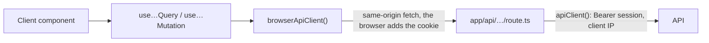

# 0017: Browser data: TanStack Query, one hook per API call, same-origin route handlers

Status: proposed (2026-11-13, OTA-184); accepted when slice 2 merges (with OTA-142). Supersedes ADR 0003's "no client-side fetching yet". The cookie flow relies on ADR 0015, which stays proposed until OTA-139's runtime proof.

## Context

Until now every API call ran on the web server (ADR 0003), and ADR 0015 was built on "the browser never calls the API". Three v1 features cannot work that way: search suggestions while typing (ADR 0016 anime search, step 5), My List's next pages on scroll, and writes that must feel instant (+1 episode, favourite, add to list: OTA-142). One watchlist entry shows in up to four controls at once (card, row, header, edit popover), so they need one shared copy of it. Without a rule, each island invents its own `useEffect` fetch, race handling and rollback.

Constraints: `client.ts` is the only file that calls `fetch` (lint rule), and expected failures are `ApiResult`, never thrown (ADR 0003). The session cookie is `HttpOnly` and host-only on the web origin; the API reads no cookie and sends no CORS header (ADR 0015). Every library states its license and gzipped size (ADR 0011, 0012).

### Requirements

Functional:

1. A client island can read API data that depends on what the user does after first paint (typing, scrolling, retrying), with pending, failed and data states.
2. A member can change their data and see the change at once; a failed write puts the old value back and says so.
3. After a write, every place on screen that shows the changed data agrees with the server.

Non-functional, with numbers:

1. Size: at most 12 kB gzipped added to first-load JS (measured 10.8 kB); Lighthouse mobile stays ≥ 90 (ADR 0011).
2. Feedback: +1 episode shows the new number in the same frame as the press, with no request awaited. A failed write is rolled back when the answer arrives, at most 8 s later (the browser timeout).
3. Request volume: zero requests for data younger than its `staleTime`; a superseded suggestion request is cancelled; window focus never refetches a list (an infinite list of N pages would cost N requests).
4. Failure: at most 2 retries, only on a 500 or a 503, about 3 s of added wait. Never on a 4xx, a 429, a 502, a 504, a timeout or a write.
5. Security: browser JavaScript can never read the session token; the API still sends zero CORS headers; every non-GET handler refuses a foreign `Origin`; a member's cached data never outlives their session in a tab.

Consistency or availability: **availability for reads** (cached data shows while a refetch runs, and stays when the refetch fails); **the server decides writes** (the optimistic value is a guess: the response or the refetch replaces it, a failure rolls it back). A member reads their own writes because the mutation awaits its invalidation.

## Options

| Topic | Chosen | Rejected, and why | Cost of the choice |
|---|---|---|---|
| Library | TanStack Query (`@tanstack/react-query` 5.107.1, MIT) | **SWR** 2.5.1 (MIT, 7.9 kB gzipped): 3 kB smaller, but writes are a thinner add-on, with no per-entry ordering and hand-wired rollback. **No library** (`useEffect`, `useOptimistic`): each island rewrites cancellation, dedupe, rollback and the shared entry copy. | 10.8 kB gzipped on every page (10.5 kB without `useInfiniteQuery`), one transitive dependency (`@tanstack/query-core`), a cache to reason about. |
| How the browser reaches the API | Same-origin route handlers, `app/api/<area>/…/route.ts`, one per call | **CORS to the API**: needs a cookie on the API host or a token readable by JS; ADR 0015 rules out both. **Server Actions as `queryFn`/`mutationFn`**: Next dispatches them one at a time per client, so one slow save blocks every other call; they cannot be cancelled; an open tab fails after a deploy (action ids change). **A catch-all proxy**: every API route reachable with the member's session. | One Vercel function call and one extra hop per browser request (the hop Server Components already pay). One small handler file per call. |
| Network code in the browser | Reuse `createApiClient` on base `<origin>/api`; `client.ts` keeps only that isomorphic factory | A second `fetch` wrapper | `apiClient()` and the `session`, `clientIp` and internal-key options move to a `server-only` file with no `fetch` in it, so pages change one import. In return: the marker planned in ADR 0003 lands, the network lint rule is unchanged, and there is one failure union and one set of guards. |
| Failures inside TanStack | The hook throws `ApiFailureError` (it holds the `ApiFailure`) inside `queryFn`/`mutationFn` only | `ApiResult` as query data: a failed refetch would overwrite good cached data, and retry, `onError` rollback and `isError` would never fire. | The compiler no longer forces the failure branch (see Consequences). |
| First paint | Server Components fetch; an island gets its data as a prop and seeds its hook with `initialData` | `prefetchQuery` + `HydrationBoundary` | Some data exists twice (see Consequences). In return: no server-side query cache, no hydration code. |

## Decision

**When to use what.** Data known at request time: a Server Component, still the default. A form that ends in a navigation (auth, settings): a Server Action (ADR 0015). Data that depends on typing, scrolling or a press that must feel instant: a hook from this record. Nothing else fetches in the browser.

**Route handlers.** `apps/web/app/api/<area>/…/route.ts`, one per call, never a catch-all `[...path]`; the path mirrors the API path (`GET /api/anime/search`, `PATCH /api/me/list/:animeId`). A handler validates its input, reads the session cookie, calls `apiClient()` with the typed `session` and `clientIp` options (ADR 0015) and answers through one shared helper:
- Success: the data. `api_error`: the same status and the rebuilt envelope, with `Retry-After` re-sent on a 429. `invalid_response`: 502, as the `/hikari` tunnel answers a bad upstream (ADR 0003). `network`: 503. `timeout`: 504. All three carry `SERVICE_UNAVAILABLE`.
- The handler's own refusals use the same envelope through the same helper: 400 `VALIDATION_FAILED` for bad input, 401 `UNAUTHORIZED` (the code comes with OTA-139) for a member route without a cookie, with no API call, and 403 for a foreign `Origin`. `API_ERROR_CODES` has one 403 code today, `INTERNAL_KEY_REQUIRED` ([ADR 0019](0019-internal-api-key-and-visitor-import-limit.md)): the API refused the web server's own key, so it is shown as "service unavailable" and never relayed to the browser. Slice 2 adds the foreign-`Origin` code.
- A 401 from the API deletes the stale cookie, and the browser clears its cache (see Provider).
- **Client IP.** The handler takes it only from Vercel's `x-forwarded-for` (Vercel overwrites it), never from a browser header or the body. The API honours `X-Client-Ip` only with a valid `X-Internal-Api-Key`; otherwise it counts its own peer IP. Superseded on this point by [ADR 0019](0019-internal-api-key-and-visitor-import-limit.md): without the key there is no per-visitor count, and once the key is set such a request is refused.
- Always `Cache-Control: private, no-store`. TanStack's cache is the only cache.
- Every non-GET handler calls `assertSameOrigin()`, and a GET never changes state. No CSRF token and no CORS, as in ADR 0015.

**Browser client.** `browserApiClient()` in `apps/web/src/api/browser-client.ts` is `createApiClient({ baseUrl: origin + '/api', defaultTimeoutMs: 8000 })`. It returns the same `ApiResult`, with the same guards and envelope rebuild. 8 s lets the handler's own 5 s timeout answer first. `CallOptions` gains `signal`, so TanStack can cancel a superseded request. `client.ts` keeps only the isomorphic factory: `apiClient()`, `API_BASE_URL`, the internal key and the `session` and `clientIp` options live in a `server-only` file that calls no `fetch`. The browser client's type has none of those options, and the lint rule does not change.

**Hooks.** One file and one hook per API call, in `apps/web/src/api/<area>/`: `use<Thing>Query.ts`, `use<Thing>InfiniteQuery.ts`, `use<Action><Thing>Mutation.ts`. Components never import `@tanstack/react-query`; ESLint allows that import only under `src/api/**` (slice 2).
- **Keys.** `use<Thing>Query.getQueryKey(params)` returns `[area, thing, params]`. No key is written anywhere else.
- **Reads.** `queryFn` calls `browserApiClient()` with an `isExpectedBody` guard and the `signal`. One helper wraps every `queryFn` and `mutationFn`: `ok` gives `data`, a failure becomes `throw new ApiFailureError(failure)`, and any other error (a programming or configuration error from `client.ts`) is rethrown unchanged. So `error` stays typed `Error`. Components and the retry rule read it through one `instanceof` helper that returns the `ApiFailure` or nothing; they never assume `error.failure`. The throw never reaches a component: no `throwOnError`, no `useSuspenseQuery`.
- **Writes.** A mutation hook invalidates what it changed, itself, through the query hooks' `getQueryKey`, and returns that promise from `onSettled`, so the mutation stays pending until the refetch is in. Callers only add UI effects (close a popover).
- **State.** Never copy `query.data` into `useState` through `useEffect`. Render `query.data`; state holds only the user's unsaved draft (`draftScore ?? entry.score`).

**Defaults**, in one `QueryClient` config under `src/api/query/`: `gcTime` 5 min; `retry` at most 2, only for an `ApiFailure` with status 500 or 503; `retryDelay` 1 s then 2 s, with jitter (TanStack's default has none); mutations never retry. Every query hook names its data kind:

| Kind | `staleTime` | Refetch on focus | Example |
|---|---|---|---|
| `suggestion` | 60 s | no | search suggestions |
| `catalogList` | 5 min | no | browse lists (the API refreshes them hourly at most, ADR 0016 catalog lists) |
| `viewerList` | 30 s | no | My List pages |
| `viewerEntity` | 30 s | yes | one watchlist entry, the list summary |

**Provider.** One `QueryProvider` client component in the root layout. It keeps one `QueryClient` per browser tab and makes a new one per server render, never a module-level one on the server (one member's data could reach another). It reads no cookie, so the layout stays static (ADR 0003). Queries never run during server render.

**The browser cache outlives a session.** Sign-in and sign-out are redirecting Server Actions, the tab keeps its `QueryClient`, and keys carry no viewer, so member A's data could render for member B for `gcTime`. So the cache is cleared (`queryClient.clear()`, running mutations cancelled) on sign-in, sign-out and any 401 from a member route. Slice 2 picks the trigger and tests it: A signs out, B signs in on the same tab, nothing of A's renders. Candidate: an island in the header's `Viewer` slot that clears when the viewer changes, plus the cache-level `onError` for the 401.

**Optimistic +1 episode** (favourite and score follow the same pattern).
- The mutation sends the resulting episode number, not "+1", so a repeat changes nothing.
- `onMutate`: cancel the entry's queries, keep the previous entry, write the new number with `setQueryData`. `onError`: put the previous entry back.
- `onSettled`: invalidate only when no other mutation for that entry is still running, so a refetch cannot undo a later press. `scope: { id }` per entry sends its presses in order.
- The number swaps with no animation (ADR 0011). XP and "Completed" come from the server's answer, never from the guess.
- Failure surface: an inline message with Retry next to the entry, as OTA-142's approved design says, and a Sonner toast only where that design asks for one. The ticket said "toast"; the design is more specific, and ten failed presses must not stack ten toasts. Sonner arrives with OTA-142 (ADR 0012).

## Consequences

- **The compiler no longer forces the failure branch.** `query.data` is `T | undefined`, so a component must handle "no data", but nothing makes it render `error`. The React checklist asks for pending, failed and data states, and hook tests cover each `ApiFailure` kind the UI treats differently.
- **`ApiResult` holds everywhere except inside a hook.** `ApiFailureError` is built in one helper and caught by TanStack. It holds only the `ApiFailure`, so nothing raw travels with it (ADR 0003).
- **Some data exists twice.** A Server Component's HTML and the query cache can disagree after a write. Rule: one owner per value on a page. A value a mutation can change is rendered by an island from its hook; if a server-rendered part shows it too (a count in the header), the mutation hook also calls `router.refresh()`. OTA-142 is the first test of this rule.
- **Every browser call costs a Vercel function call and an API call.** Suggestions are the busy one, bounded by 3 characters minimum, a 250 ms debounce and the 60 s cache. Not checked against the Hobby quota. If it hurts, caching suggestion answers at the CDN needs an amendment to this record, since it breaks "always `private, no-store`": public routes only, no cookie read, no `Set-Cookie`.
- **The API sees the web server's IP.** The per-client limit (OTA-189) must count the forwarded client IP (ADR 0015), or every visitor shares one bucket. The API trusts that IP only with the internal key (see Route handlers), so every proxied call sends both, and a caller without the key cannot pick its own bucket.
- **Every page pays 10.8 kB**, guests on the home page included, because the header search box is on every page. If OTA-148's budget is at risk, load the suggestion island with `next/dynamic` and move the provider under it.
- **An old tab after a deploy** keeps calling `/api/…` URLs, which stay stable. A changed payload gives `invalid_response` through the guard instead of a crash, which is why the guard is required in hooks.
- **Browser floor.** `client.ts` needs `URL.parse` (Chrome 126, Firefox 126, Safari 18) and, with `signal`, `AbortSignal.any` (Safari 17.4). Slice 2 either replaces `URL.parse` or records the floor.
- **Too simple?** Not handled: two tabs or devices writing the same entry (last write wins; the focus refetch repairs the display) and offline writes (they fail and roll back). Both are acceptable for a personal list.
- **Too complicated?** Left out on purpose: hydration, a persisted cache, devtools, polling, cross-tab sync, code generation, a generic proxy. One file per call is more files, but about ten hooks cover v1.

## Learnings

(Filled in after slice 2 and OTA-142.)

## Follow-up tickets

- **Slice 2, with OTA-142.** Slice 1 is this record and the rule in `.claude/rules/web.md`: no dependency, no code. `package.json`, the lockfile and `eslint.config` are protected paths (Farouk merges), and an example hook with no consumer would be dead code. Slice 2 adds: `@tanstack/react-query` pinned, `QueryProvider` with the session cache reset and its test, `browserApiClient()`, the `server-only` file for `apiClient()` (the package needs a Vitest alias, ADR 0003), the unwrap and `instanceof` helpers with `ApiFailureError`, the route-answer helper, a 403 code in `API_ERROR_CODES`, the lint rule, `/api/` in the always-noindex paths, and the first real hooks with tests (success, each failure kind, invalidation, rollback). It re-measures the size in Next's build output.
- **ADR 0003 addendum** in slice 2: `signal` in `CallOptions`, `client.ts` in the browser bundle, `apiClient()` in the `server-only` file, `URL.parse`. CLAUDE.md still names `client.ts` as the home of `apiClient()` (protected path, Farouk).
- **OTA-139** provides `assertSameOrigin()`, `UNAUTHORIZED` and the `session` and `clientIp` options; whichever of OTA-139 and slice 2 lands second moves them to the `server-only` file. If ADR 0015 falls back to Better Auth, the flow keeps its shape: cookie on the web origin, the handler forwards.
- **Search suggestions** (ADR 0016 anime search, step 5) and OTA-136's Retry island use these hooks.
- `.claude/skills/vercel-react-best-practices` notes still say the library is pending (protected path, Farouk).

## Sources checked 2026-11-13

- npm registry (`npm view`): `@tanstack/react-query` 5.107.1, MIT, depends on `@tanstack/query-core` 5.107.1 (MIT, no dependencies), peers `react ^18 || ^19`. `swr` 2.5.1, MIT. `sonner` 2.0.8, MIT. `LICENSE` files read in both TanStack tarballs.
- Size: measured here, outside the repo, with esbuild 0.28.2 (minified ESM, React external, gzip level 9). `QueryClient`, `QueryClientProvider`, `useQuery`, `useMutation`, `useQueryClient`: 35.5 kB minified, 10.5 kB gzipped; with `useInfiniteQuery`: 10.8 kB. SWR with its mutation and infinite hooks: 7.9 kB. Next's bundler will differ a little.
- `@tanstack/query-core` 5.107.1 types and source: `MutationScope` ("mutations with the same `id` run one after another"), `defaultRetryDelay` (doubling from 1 s, capped at 30 s, no jitter).
- Next 16.4.5 docs, read from the npm tarball (`node_modules` is not installed in this run): `02-guides/server-actions.md` (sequential dispatch, `Origin` check, action ids and deploys, a cookie change re-renders the route), `02-guides/backend-for-frontend.md` ("Server Actions are queued"), `03-file-conventions/route.md` (cookies in route handlers); `unstable_rethrow` has a browser build.
- `@mdn/browser-compat-data` 8.1.9: `URL.parse`, `AbortSignal.any`, `AbortSignal.timeout`.
- Not verified: bundlephobia (blocked by the proxy), the Vercel Hobby function quota, TanStack's guide for the App Router provider (written from memory), and anything at runtime (no code in this slice).
