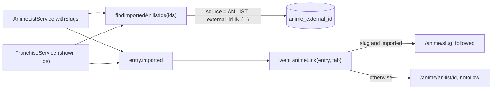

# 0018: `imported` on listed and franchise entries, and which anime link the web renders

Status: proposed (2026-11-13, OTA-191); accepted when slice 2 (web) merges. Amends ADR 0016 catalog lists (warm path: 3 queries become 4) and ADR 0008 item 9 (entry shape).

## Context

Since OTA-190, an anime on a stored catalog list gets an identity and a slug before anyone opens it. The web reads `slug !== null` as "imported" (`seasonHref`, the selector's `rel`, `cardHref`), so those links moved from `/anime/anilist/:id` (nofollow, `Disallow` in robots.txt, always noindex) to `/anime/<slug>`. Indexing is allowed at launch (2026-11-30, OTA-149). A crawler would then open every listed slug: each is a cold import that takes an `ImportLimits` token (10, one back per 20 s) and a page view that keeps the anime past the 30-day purge, which is the mass collection ADR 0006 forbids. Home cards are safe today only because every card is nofollow, which also hides imported anime from crawlers.

### Requirements

Functional:

1. The API says, for each entry of `GET /anime/lists/:kind` and of `GET /anime/slugs/:slug/franchise`, whether we hold the anime now.
2. The web links an anime we hold to `/anime/<slug>` (followed), and any other to `/anime/anilist/:id` with `rel="nofollow"`, on the season selector and on cards.
3. A person clicking either link reaches the anime page; card links are never prefetched.

Non-functional, with numbers:

1. Crawl cost: a crawler that obeys robots.txt and follows every followed anime link of a response spends 0 `ImportLimits` tokens.
2. Read cost: +1 primary-key query per response (at most 50 ids on a list), 0 writes, 0 source calls. The list warm path goes from 3 to 4 queries; p95 target stays 50 ms.
3. Schema: 0 migrations, 0 new columns.
4. Deploy order: old web + new API and new web + old API both answer 200 with working links; a missing field means "not imported".
5. Staleness: the flag is read per request. A stale `false` costs one redirect hop (a stored lookup, no token); a stale `true` costs at most 1 token per followed link, inside the existing 3 imports a minute.

Consistency or availability: **availability**. A flag that is one render old harms nobody; it is never worth a lock or a write.

## Options

1. **Derive `imported` from the existing rows: an `anime` row linked to the AniList id.** Chosen. `anime_external_id` has the primary key `(source, external_id)`, and it is the same link `AnimeService.findStored` uses to decide between serving and importing, so the flag is true exactly when the slug page costs no import.
2. **An `imported_at` column on `anime_identity` (OTA-192).** Rejected for this ticket: a migration is a protected path and needs a backfill, and it answers another question. A purged anime keeps `imported_at` but its slug page is a cold import again, so a link chosen from it would still spend tokens. OTA-192 keeps its own purpose (releasing slugs never imported) and must not redefine `imported`.
3. **The API answers `slug: null` until the anime is imported.** Rejected: no web change is needed, but it is a behaviour change, not an additive field; it hides the slug OTA-190 claims on purpose; and it keeps one field carrying two meanings, which is how this bug happened.

## Decision

**Core entities:** `Anime`, `AnimeExternalId`, `AnimeIdentity` (exist, unchanged); `AnimeListEntry`, `FranchiseEntry` (one new field); `AnimeLink` (web, new).

**API.** No new route. `imported: boolean` is added to every entry of both responses, always present:

- `true`: an `anime` row is linked to this AniList id now.
- `false`: never imported (slug claimed by a list, or no slug), purged after 30 days unviewed, or manga.

All four pairs of `slug` and `imported` are valid. Search hits need no field: search reads stored anime only.

**Data flow**

**Design, simplest first.**

- API: one function, `findImportedAnilistIds(prisma, anilistIds)`, returns the set of ids that have an `anime_external_id` row with source `ANILIST`; an empty input sends no query. Both services call it next to their `anime_identity` lookup (`Promise.all`) and set the field. `currentFromCore` sets `true`: it only answers when the snapshot exists.
- Shared types: `AnimeListEntry.imported` and `FranchiseEntry.imported` are required, so the compiler makes every API producer set them. The web-trusted `AnimeListCard` carries `imported?: boolean`. `isAnimeListPage` and `isAnimeFranchise` accept an absent field and reject one that is present and not a boolean.
- Web: one pure function, `animeLink(anime, segment = '')`, returns `{ href, rel }`.

| `slug` | `imported`       | `href`                       | `rel`      |
| ------ | ---------------- | ---------------------------- | ---------- |
| set    | `true`           | `/anime/<slug>[/tab]`        | none       |
| set    | `false`, missing | `/anime/anilist/<id>[/tab]`  | `nofollow` |
| null   | any              | `/anime/anilist/<id>[/tab]`  | `nofollow` |

It replaces `seasonHref` and `cardHref`, and the two inline `rel` rules. The field is compared with `=== true` in `animeLink` and in `seasonOptions`, nowhere else. Every anime link keeps `prefetch={false}`.

### Deep dives

- **Crawl cost (1).** A followed link exists only for an anime whose row was there when the page rendered, and `findStored` finds that same row, so the slug page serves without `importNew`. The id route stays disallowed and noindex.
- **Read cost (2).** Both lookups are `IN` lists on a primary key, the same ids the identity query already uses, run together. No join and no raw SQL: `anime_identity` has no relation to `anime` on purpose (ADR 0007).
- **Deploy order (4).** Old web + new API: the guards ignore an extra field, nothing changes. New web + old API: every link is the id route with nofollow; an imported season costs one extra stored lookup and a 307. Either order is safe; API first avoids that slower window.
- **Staleness (5).** Home rows and the franchise are loaded per request. An import shows on the next render; a purge between render and click is one bounded import.

## Consequences

Too simple, on purpose:

- **A purged anime is `imported: false`.** Its links go back to the nofollow id route until someone opens it again. That is the intent of ADR 0006 (keep what visitors open), and it costs some internal link weight for pages nobody visits.
- **Only polite crawlers are covered.** A crawler that ignores robots.txt and nofollow, or one that re-crawls a slug URL it already knows, still imports. `ImportLimits` bounds the rate; a per-client limit is OTA-189.
- **A cached render would freeze the flag.** If a list page is ever cached (`use cache`, ISR), its lifetime becomes the staleness bound in requirement 5 and must be chosen with that in mind.
- **A future sitemap must list imported anime only**, or it reopens this door.

Too complicated, not built: a migration or marker column, a link-kind union in the API, one raw SQL statement to save a query, a resolve call per card, tightening the guards later (a missing field stays tolerated: it costs nothing and keeps an API rollback safe).

Slices: 1 = shared types, API, docs (this ADR); 2 = web. PR #80 (OTA-137) moves the card to `src/browse/anime-card.tsx` and still imports `cardHref`: whichever lands second switches that card to `animeLink`.

## Learnings
