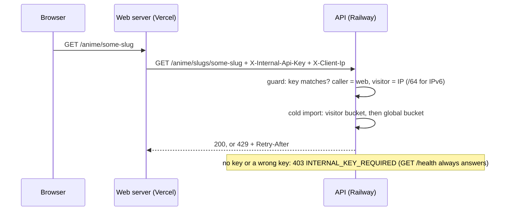

# 0019: Internal API key on every route, and a per-visitor cold-import limit

Status: proposed (2026-11-13, OTA-182). Accepted when the web sends the key (slice 2) and the key is set in production. Builds the internal key of [ADR 0015](0015-authentication.md) earlier and for every route, with the same names. Changes one line of it: until OTA-139, production starts without the key (see Rollout).

Built so far: items 1 to 6 (OTA-182 PR A), the guard (`apps/api/src/common/internal-key.guard.ts`), off until `INTERNAL_API_KEY` is set; items 7 to 12 (PR B), `ApiCaller` (`apps/api/src/common/api-caller.ts`), the visitor buckets in `ImportLimits` and `Retry-After`; PR C, the preview key (Consequences), the `INTERNAL_API_KEY_REQUIRED` boot flag and the Sentry message when production starts open. Next: the web side (slice 2, PR #86), then slice 2b (the web reports a refused key to Sentry).

## Context

The Railway API domain is public and checks no caller ([ADR 0006](0006-anime-data-sources.md), update of 2026-11-12, "Known limits"). Three requests a minute with unknown ids, sent straight to the API, keep the global cold-import bucket (OTA-173: 10 tokens, one back per 20 s) empty: every visitor's first-visit import answers 429. Through the web the API only sees Vercel's addresses, so it cannot tell one visitor from another either.

Constraints: web (Vercel) and API (Railway) deploy separately, so each step must work with the other app one version behind (OTA-183). The beta deploys before Farouk sets any variable. One API instance (ADR 0009). No new dependency, no table. Vercel Hobby has no fixed egress addresses and cannot reach Railway's private network.

### Requirements

Functional:

1. The web server can call every API route; a caller without the shared secret gets an error envelope, except on `GET /health` (Railway's deploy gate and monitors).
2. A visitor who opens many anime we do not hold is refused alone; other visitors keep importing.
3. Farouk can turn the check on, rotate the secret and turn it off without a code change and without a window where the site answers errors.

Non-functional, with numbers:

1. Isolation: one visitor takes at most 5 cold imports at once and 1.5 a minute after that, which is half the global burst (10) and half the global refill (3 a minute). A caller without the key takes 0 once the check is on.
2. Cost: the check adds no I/O and under 0.1 ms per request (one SHA-256 digest of at most 512 bytes per key group, the production keys then the preview key, and one constant-time compare per accepted key; the accepted keys are hashed once at start).
3. Memory: at most 10,000 visitor entries (about 1.5 MB), each expired 200 s after its last import and removed at the next granted import of any visitor.
4. Rollout: 0 failed requests caused by deploy order. New API with the old web and no key set behaves exactly as today; a rotation has 0 refused requests.
5. Secrecy: the key has 256 bits of randomness, lives only in env vars, and never appears in a log line, a URL, an error body or a test fixture.

Consistency or availability: **availability.** Limiter state is in memory, per process, lost on restart; a lost counter costs a few extra imports, never wrong data. The check itself is open while no key is configured (availability during rollout) and closed once one is: a wrong key is refused, there is no degraded mode.

### Core entities

`InternalApiKey` (the secret), `ApiCaller` (who the guard decided is calling), `VisitorKey` (what a visitor's imports are counted under), `ImportLimits` (the existing global bucket, plus one bucket per visitor). No table.

## Options

| Topic | Chosen | Rejected, and why |
|---|---|---|
| Who may call the API | A shared secret header checked by a global Nest guard | **Railway private network only**: Vercel cannot reach it. **Allowlist of Vercel addresses**: Hobby has no fixed egress addresses. **Signed requests (HMAC plus timestamp) or mTLS**: they stop replay of a captured request, which TLS already prevents; more code for a threat we do not have. |
| Where the check runs | `APP_GUARD` plus a `@PublicRoute()` marker on the health controller | **Express middleware in `main.ts`**: it would also cover unknown paths and Swagger, but its errors skip the exception filter (the envelope would be written by hand) and `test-app.ts` would have to mirror it. The repo is public, so "which routes exist" is not a secret. |
| Per-visitor counting | In-memory buckets inside `ImportLimits`, taken only when this caller starts an import | **`@nestjs/throttler`**: a new dependency that counts requests, and cached pages must stay free. **Postgres counters** (as ADR 0015 does for sign-in): a write per cold visit for state worth 200 s; the global bucket it sits in front of is in memory too. |
| Visitor identity | The client IP the web forwards in `X-Client-Ip` (ADR 0015, 0017), IPv6 cut to its /64 | **A second `X-Visitor-Key` header**: two headers for the same fact. **A cookie id**: a crawler drops cookies. |
| Without a trusted IP | No per-visitor count when the check is off; one shared bucket when the key matched but no valid IP came | **The socket address**: on Railway it is the platform proxy's, not the caller's (not verified by running), and in tests it is always loopback. |

## Decision

**Names** (from ADR 0015): env `INTERNAL_API_KEY` and `INTERNAL_API_KEY_PREVIOUS`, read by both apps; headers `X-Internal-Api-Key` and `X-Client-Ip`. New here, API only: `INTERNAL_API_KEY_PREVIEW` and `INTERNAL_API_KEY_REQUIRED`. New error codes: 403 `INTERNAL_KEY_REQUIRED` and 429 `ANIME_IMPORT_VISITOR_LIMIT_REACHED`.

**Simplest version first: the guard.**

1. `INTERNAL_API_KEY` is optional in the API's env validation. Set, it must be 43 to 128 characters of `[A-Za-z0-9_-]` (`openssl rand -hex 32` gives 64); `INTERNAL_API_KEY_PREVIOUS` follows the same rule and is refused without the first. `INTERNAL_API_KEY_PREVIEW` follows the same rule and is refused when equal to either of them (a plain comparison at boot, not against a request). `INTERNAL_API_KEY_REQUIRED` is `true` or `false`. Messages name the variable, never the value. An empty value means unset.
2. Unset: the guard lets every request through and the API logs one warning at start in production ("INTERNAL_API_KEY is not set: the API answers any caller"), also sent to Sentry as an error-level message (an open production API is an error). Production still starts: a refused boot would fail Railway's health gate and block every deploy until a variable is set by hand. Once the key is on, `INTERNAL_API_KEY_REQUIRED=true` makes the API refuse to boot without `INTERNAL_API_KEY` (any `NODE_ENV`; the preview key does not count), so a deleted variable fails the deploy and the old deployment keeps serving.
3. Set: every routed request must carry the key or the previous key. Both sides are hashed with SHA-256 and compared with `timingSafeEqual`, so neither length nor content leaks through timing. A missing, wrong, repeated or over-long header gets the same 403 `INTERNAL_KEY_REQUIRED`: a prober learns nothing from the difference.
4. Why 403 and not 401: on this API a 401 will mean "your session is gone" (ADR 0015), and the web clears the member's browser cache on it (ADR 0017). A misconfigured key must not look like a sign-out.
5. `GET /health` carries `@PublicRoute()` (a method decorator only, so a whole controller cannot be opened by accident) and never looks at the header. A test lists the routes and fails if any other handler carries the marker (`internal-key.integration.spec.ts`). The header name and both variable names match the redaction pattern of ADR 0004; a test pins it.
6. Not covered, on purpose: an unknown path answers 404 and a malformed or oversized body answers 400 or 413 before the guard (the body parser runs first, capped at 100 kB). Swagger (`/docs`, off in production) is not a Nest route and stays reachable in development.

**Then the per-visitor limit.**

7. The guard records an `ApiCaller` for the request: `open` (no key configured), `web` with a `visitorKey`, or `preview` (the preview key matched on a GET or HEAD; checked after the production keys). Preview is read-only: any other method with the preview key gets the same 403, and credential routes still allowlist `web` only (OTA-139). `X-Client-Ip` is read only for a `web` caller; every `preview` caller shares the one visitor key `preview`, which no IP can produce. A valid IPv4 is the key as it is; an IPv4-mapped IPv6 becomes the IPv4; an IPv6 is cut to its first 64 bits (one home line owns a whole /64). Missing or invalid (a list, a zone id, text): the shared key `unknown`, so a call site that forgets the header shows up as early 429s instead of having no limit.
8. `ImportLimits` gains one bucket per visitor: 5 tokens, one back every 40 s. Entries are kept in last-used order (only a granted take counts as use), expire once full again (200 s), and are capped at 10,000 (the oldest goes first). Removal is lazy: each granted take first drops the expired entries at the front, then the oldest over the cap; no timer. An expired entry is a full bucket, so keeping it a little longer changes no answer. The refill arithmetic is one pure function shared with the global bucket.
9. Order in the importer. An import already running for that id is joined for free, as today. Otherwise the caller's visitor token is taken **before** the shared import starts, so the 429 goes only to the visitor who caused it and is never handed to the others waiting on the same id. Then the global token, as today.
10. A token is spent only when a source request was sent. The visitor token comes back when the anime turned out to be stored, known missing, removed, when no source can look it up, when the global bucket was empty, or when the database failed first; both tokens come back when every source refused before sending. "Refused before sending" is `requestSent` false **and** a pre-send reason (queue full, cooling down, backed off after an unusable answer): `requestSent` alone is not enough, because a failure after a real request (HTTP 5xx, timeout, non-JSON, `UnusableAnswerError`) also leaves it false (`refusedBeforeSending` in `sources/source.types.ts`). Any answer or any other error counts as sent. One `finally` in the import gives back.
11. An `open` caller skips the visitor bucket: without the key nobody can be told apart, and a shared bucket of 5 would make the beta stricter than it is today.
12. Answers: visitor limit 429 `ANIME_IMPORT_VISITOR_LIMIT_REACHED` with `Retry-After` set to the seconds until that visitor's next token (1 to 40); global limit 429 `ANIME_IMPORT_LIMIT_REACHED` with `Retry-After: 20`. `ApiException` gets a typed `retryAfterSeconds`; the filter sets the header. No free-form headers.

**Web side (slice 2, next PR).** The server-side `apiClient()` adds `X-Internal-Api-Key` itself when `INTERNAL_API_KEY` is set, and refuses to send it to an `API_BASE_URL` that is neither HTTPS nor loopback (ADR 0015). `X-Client-Ip` is a typed per-call option, copied from Vercel's `x-forwarded-for` (Vercel overwrites it) and never from a browser header or a body. It is sent only on calls that can start an import: a per-visitor header on a cached `fetch` would split Next's data cache by visitor. A 403 `INTERNAL_KEY_REQUIRED` is shown as "service unavailable" and reported to Sentry, never relayed to the browser.

**Rollout** (expand, migrate, contract):

1. API merged, key unset: nothing changes.
2. Web slice 2 merged: sends the key when it has one.
3. Farouk sets the preview key: `INTERNAL_API_KEY_PREVIEW` on Railway (inert while the key is unset), then the same value as `INTERNAL_API_KEY` in Vercel's Preview environment only, marked Sensitive.
4. Farouk sets the key on Vercel and redeploys, then on Railway. From that restart the check is on. Check: `curl -i '<api>/anime/search?q=a'` answers 403, `curl -i '<api>/health'` answers 200, the site and a preview load. The production key goes in Vercel's Production environment only.
5. Farouk sets `INTERNAL_API_KEY_REQUIRED=true` on Railway and resolves the Sentry issue of the open start.
6. OTA-139 makes the key required in production (ADR 0015) and makes credential routes accept only a `web` caller: they refuse `open` and `preview` whatever the guard's mode.

Rotation: set `INTERNAL_API_KEY_PREVIOUS` to the old key and `INTERNAL_API_KEY` to the new one on Railway; change Vercel and redeploy; remove the previous key. The preview key rotates without overlap (no previous preview key): previews built before the change get 403 until rebuilt. Rolling the web back to a build older than slice 2: unset `INTERNAL_API_KEY_REQUIRED` on Railway first, then the key.

## Consequences

- **Vercel previews would go dark the day the key is set.** Previews call the production API (`docs/deploy-vercel.md`) and ADR 0015 keeps the production key out of the Preview environment. Built (PR C): a third variable on the API, `INTERNAL_API_KEY_PREVIEW`, which passes the guard as a `preview` caller: never trusted for `X-Client-Ip` (all previews share one visitor bucket) and never for a credential route. Alone it is inert: without `INTERNAL_API_KEY` the check stays open, so the preview key can never be what closes it. Equal to `INTERNAL_API_KEY` or `INTERNAL_API_KEY_PREVIOUS`, the API refuses to boot. Vercel's Preview environment holds that value under the same name `INTERNAL_API_KEY`, so the web needs no extra code, but it must tell a preview by `VERCEL_ENV`, never by the key being absent (ADR 0015). It lands at ADR rollout step 3, before the production key. The production key must never go in Vercel's Preview environment (preview code would hold the production secret, and every preview build would carry it): until the preview key is set, previews stay dark.
- **Rollout gate: both import routes must send `X-Client-Ip`.** Before the production key is set (ADR rollout step 4), check that the web sends it on `GET /anime/slugs/:slug` and `GET /anime/:idSource/:externalId` (a test in slice 2 and a look at production logs for the `unknown` visitor warning): a route that forgets it puts every visitor in the one shared `unknown` bucket of 5.
- **Open by default is a failure mode.** A deleted variable, or a new Railway environment, reopens the API. The start-up warning is no longer the only signal: it also opens a Sentry issue (error level; the alert rule must also fire when a resolved issue comes back), and from ADR rollout step 5 `INTERNAL_API_KEY_REQUIRED=true` turns a deleted key into a failed deploy. A new environment without the flag still starts open, with the warning.
- **A leaked key** lets its holder call the API and choose any `X-Client-Ip`. Rotate it; the global bucket still bounds imports.
- **Shared addresses share a bucket**: a campus, a mobile carrier or a VPN exit gets 5 imports at once between all its users. Cached pages are unaffected.
- **Many addresses still drain the global bucket.** This stops one crawler, not a botnet; the next step is a Vercel firewall rule, as ADR 0006 already says.
- **Accepted risk: a large IPv6 allocation is many visitors.** The key is the /64, so whoever holds a /56 (256 keys) or a /48 (65,536 keys) gets that many visitor buckets of 5; only the global bucket bounds them. A coarser bucket per /48 in front is a follow-up (below).
- **In memory**: every deploy refills every bucket, and a second API instance doubles each limit. Same trade as OTA-173.
- **A limited visitor asking for a known-missing id** gets 429 instead of 404 until a token is back. So does one asking, by an id we have not linked yet, for an anime we already store (e.g. stored from AniList without its MAL id, asked by MAL id): it goes through the importer, so it takes a visitor token first (given back once the import finds it stored).
- The client IP is personal data: it lives only in the API's memory, from an import until the next import of any visitor at least 200 s later (or until 10,000 newer visitors push it out, or a restart), and is never logged; the refusal warning only says whether the shared `unknown` key was refused. The privacy page should say IPs are used for rate limiting (check with OTA-147).
- ADR 0006 ("the API only sees Vercel's addresses", known limit) and ADR 0017 ("otherwise it counts its own peer IP") get a pointer here: without the key there is no per-visitor count, and once the check is on such a request is refused.

**Too simple?** Yes in three places, accepted: open when unset (above), no check on unknown paths or before body parsing, and no limit per signed-in member (an IP is all we have before accounts). **Too complicated?** Three parts look optional and are not. The previous key: with a guard on every route, a rotation without overlap is a site-wide outage between two dashboards. The /64 cut: without it one IPv6 host has 2^64 visitor keys. The preview key: without it either previews break or preview code holds the production secret. Left out on purpose: Redis, a throttler library, request signing, a per-route allowlist of callers.

## Learnings

To fill in after the rollout.

## Follow-up tickets

- **OTA-182 slice 2**: web sends the key and the client IP; `.claude/rules/web.md`; ADR 0003 addendum (shared with OTA-139).
- **OTA-189**: per-visitor limit on list and search, reusing `ApiCaller` and the same bucket function.
- **OTA-139**: key required in production; credential routes allowlist the `web` caller only (`open` and `preview` refused).
- **OTA-182 slice 2b**: the web reports a refused key (403 `INTERNAL_KEY_REQUIRED`) to Sentry.
- A coarser visitor bucket per IPv6 /48 in front of the /64 one, so one large allocation cannot take thousands of buckets (accepted risk above).
- Cache the `/health` result for about 1 s, so a public route cannot be used to load the database.
- Swagger: an api-key security scheme for `X-Internal-Api-Key` and the 403 `INTERNAL_KEY_REQUIRED` answer on every route.
- Not in this ADR (other nits in the OTA-182 notes): AniList 404 only when `data.Media === null`; remember every id on the adult path; `rel="nofollow"` on season links without a slug.
