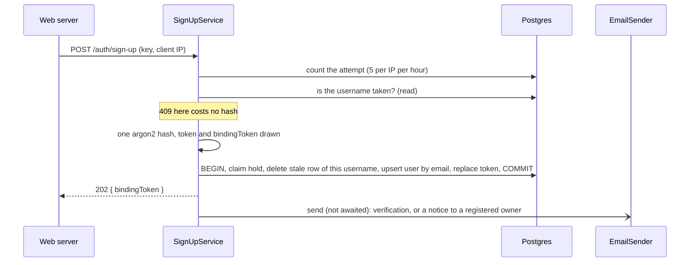

# 0020: Sign-up and email verification (OTA-139 slice 1e)

Status: proposed (2026-11-19, OTA-139 slice 1e). Details the sign-up, verification and email rows of [ADR 0015](0015-authentication.md); changes none of its routes or numbers. No schema migration. Built in three PRs: 1e-i sign-up (this PR), 1e-ii confirm and resend, 1e-iii availability and the common-password list.

## Context

ADR 0015 fixed the routes and the rules. Slice 1d added `auth_token`, `auth_username_hold` and `app_user.pending_expires_at`, and a daily cleanup that deletes an unverified user once `pending_expires_at <= now`. This slice writes those rows for the first time, so it decides the statements, their order and what happens when two requests meet.

Constraints: API only. No real mail provider yet (Resend adapter, templates and the email budget are a later slice), and the beta deploys before Farouk sets any variable, so a new required variable would stop the deploy. PRs stay near 400 changed lines. The cloud run cannot execute API tests (CI only).

## Requirements

**Functional.** (1) A visitor submits a username, an email and a password and gets 202 `{ bindingToken }`, or 409 when the username is taken or held. (2) The owner of the address confirms it with the emailed token; only the browser that signed up gets a session. (3) A pending member can ask for the email again and always gets 202.

**Non-functional.**

| # | Requirement |
|---|---|
| N1 | No enumeration: a new, a pending and a registered email get the same status and body shape and cost exactly 1 argon2 hash; the 409 is decided before the email is read; mail leaves after the response. |
| N2 | No duplicate under concurrency: N submits of one username at once give exactly 1 answer 202 and N − 1 answers 409; N submits of one email leave exactly 1 `app_user` row; 0 answers 500. |
| N3 | Abuse bound: 5 submits per IP per hour, so at most 5 hashes, 5 pending users and 5 holds per IP per hour; a refused submit costs 1 upsert and 0 hashes; every pending user and hold is gone within 48 h (24 h TTL plus the daily cleanup). |
| N4 | Lock time: argon2 (tens to hundreds of ms, queue of 8) never runs inside a transaction; the sign-up transaction is at most 5 statements, each on a primary key or unique index. |
| N5 | Production creates 0 pending accounts it cannot email, and never uses the console sender. |

**Consistency over availability.** A stale read here means two members with one username or two accounts for one email, which cannot be repaired afterwards. Database down means 503; nothing is kept in memory.

## Core entities

`User` (pending, stale or permanent), `UsernameHold`, `AuthToken` (purpose `EMAIL_VERIFICATION`, with the binding hash), `AuthRateLimit`, `AuthEmail` (a message, never stored).

- **Stale** user: `email_verified_at IS NULL AND pending_expires_at <= now`. This is exactly the row the cleanup deletes.
- **Pending** user: unverified with `pending_expires_at > now`.
- **Permanent** user: verified, or unverified with no deadline (created before this slice; the cleanup never deletes it, so no route here changes or deletes it either).
- A username is **taken** when a hold with `expires_at > now` exists, or a user row with that `username_key` exists and is not stale. One function, shared by the 409 and by availability.

## API

All three need `X-Internal-Api-Key` and `X-Client-Ip` (`CredentialGuard`) and answer `Cache-Control: no-store`.

| Route | PR | Limit per IP | Answer |
|---|---|---|---|
| `POST /auth/sign-up` `{ username, email, password }` | 1e-i | 5 per hour | 202 `{ bindingToken }`; 409 `USERNAME_TAKEN`; 400 `VALIDATION_FAILED`; 429 `TOO_MANY_REQUESTS` or `AUTH_BUSY`; 403 `SIGN_UP_CLOSED` when no sender exists |
| `POST /auth/email-verification/confirm` `{ token, bindingToken? }` | 1e-ii | 10 per 15 min | 200 `{ outcome }`; 400 `AUTH_TOKEN_INVALID` |
| `POST /auth/email-verification/resend` `{ email }` | 1e-ii | 10 per hour | 202 always (403 `SIGN_UP_CLOSED` when no sender exists) |
| `GET /users/availability?username=` | 1e-iii | 60 per minute | 200 `{ available }` |

Input rules: username 3 to 20 of `[A-Za-z0-9_]` (parity; so never "@"), stored as typed, `usernameKey` = `normaliseIdentifier(username)`. Email at most 254 raw UTF-16 units, checked for shape after `normaliseIdentifier`, and that output is what `email` stores and what mail is sent to. Password 8 to 128 code points after NFC with at least one digit or symbol.

## Data flow (sign-up)

## Options

- **A. The pending user row is the reservation; no hold.** One table fewer to write. Rejected: a submit with a registered email creates no pending row, so the username stays free and a second request shows the email is registered (breaks N1).
- **B. Hold row as the per-username lock, one upsert per table (chosen).**
- **C. Serializable transactions with a retry loop, or advisory locks on the username and the email.** Correct, but adds retry code and a second locking scheme next to row locks. Rejected: the hold upsert already locks the one row every sign-up of that username must touch.

Also rejected: hashing inside the transaction (row locks held for the whole argon2 queue, breaks N4); releasing the old hold when a pending email re-submits with another username (the release would depend on the email's state, breaks N1); an outbox or queue for mail (ADR 0015: a send is not idempotent, the member has "Resend").

## Decision

**Simplest version first.** One transaction that checks the username, inserts the user and the token, then prints the mail. It fails N1 (a known email hits the unique index and answers differently) and N2 (two submits both pass the check). The design below adds only what those two need.

**Sign-up (1e-i), in order.**
1. No sender (`EmailSender.canSend()` false): 403 `SIGN_UP_CLOSED` before any counter, hash or write.
2. Count the attempt: one per-IP key, 5 per hour. Refused: 429 with `Retry-After`.
3. Read "is the username taken?". Yes: 409, no hash.
4. One argon2 hash, outside any transaction. Draw the token and the `bindingToken` (32 bytes each, base64url) in every branch.
5. One transaction (READ COMMITTED), locks taken in the order hold, `app_user`, `auth_token`:
   - **Claim the hold:** `INSERT … ON CONFLICT (username_key) DO UPDATE SET expires_at = now + TTL WHERE hold.expires_at <= now RETURNING`. No row back means a live hold: 409. The locked hold row serialises every sign-up of that username until commit.
   - **Replace a stale row:** `DELETE FROM app_user WHERE username_key = … AND email_verified_at IS NULL AND pending_expires_at <= now` (the cleanup's own predicate, run early for one username; its tokens go by cascade). If a row with that key is still there, it is permanent or pending: 409.
   - **Upsert the user by email:** `INSERT … ON CONFLICT (email) DO UPDATE SET username, username_key, password_hash, pending_expires_at = now + TTL, updated_at WHERE email_verified_at IS NULL AND pending_expires_at IS NOT NULL RETURNING id`. New email inserts; a pending or stale one is re-armed in this one UPDATE; a permanent one returns no row and is left byte for byte as it was.
   - **Token:** when a row came back, delete that user's `EMAIL_VERIFICATION` tokens and insert the new one (SHA-256 of the token and of the `bindingToken`, `expires_at = now + TTL`). A 409 inside the transaction rolls it back.
6. Answer 202 `{ bindingToken }`. Then, not awaited: `email_verification` (address, username, token), or `sign_up_notice` to the owner of a permanent account. A rejected send is caught and logged without the address; no retry.

`now` is one `Clock.now()` per request, so the hold, the deadline and the token expire at the same instant. Timestamps go into raw SQL as `toISOString()::timestamptz` and no timestamp is read back from raw SQL (the pg adapter drops the offset, OTA-200).

**What the 409 reads.** A username is taken when a verified user has it, an unverified row the cleanup would not delete has it (pending, or no deadline), or a live hold has it. This supersedes the PROGRESS.md carry-over ("verified users and live holds only"): a pending row counts too, because resend re-arms it without touching the hold. Constraint on 1e-ii: resend must not move `pending_expires_at` past the username hold's `expires_at` (the hold and the row end together; resend extends both, or neither). Otherwise a name whose hold has ended but whose row lives on answers 409 to a probe while a free-looking name answers 202, and the taken/free probe tells whether an email is registered.

**Confirm (1e-ii).** Read the token row by its hash to learn the user. Then one transaction: `SELECT … FROM app_user WHERE id = … FOR UPDATE` first (the cleanup's order, user then token, so a racing re-submit or cleanup cannot deadlock it), consume with `UPDATE auth_token SET used_at = now WHERE token_hash = … AND used_at IS NULL AND expires_at > now RETURNING`, then `UPDATE app_user SET email_verified_at = now, pending_expires_at = NULL`. The session is created after commit, only when the binding matched.

| Token | `bindingToken` | Outcome |
|---|---|---|
| live, unused | matches | `verified` with `sessionToken`, `expiresAt` |
| live, unused | absent | `verified`, no session (the explicit "Confirm my email" click) |
| live, unused | present, wrong | `confirmation_required`, nothing consumed |
| found (used or not), user already verified | any | `already_verified`, never a session; checked before the rows above |
| not found (unknown, cancelled, cleaned up), malformed, or used or expired with an unverified user | any | 400 `AUTH_TOKEN_INVALID` |

This table is replaced by the one in the Addendum (1e-ii): the second row (binding absent, `verified`) was the pre-hijack hole.

**Resend (1e-ii).** `UPDATE app_user SET pending_expires_at = now + TTL WHERE email = … AND email_verified_at IS NULL AND pending_expires_at > now RETURNING id, username`. No row (unknown, permanent or stale): 202, nothing sent. Otherwise replace the token and copy the old row's `binding_hash`, so the browser that signed up keeps its one-click path. Resend does not touch the hold: the "taken" rule reads the pending row itself, which is why that rule is wider than "verified users and live holds". The UPDATE of `pending_expires_at` is dropped by the Addendum (1e-ii): it breaks the constraint in "What the 409 reads".

**Email (1e-i).** `EmailSender` is an abstract class with `canSend()` and `send(email: AuthEmail)`; `AuthEmail` is a union of `email_verification` and `sign_up_notice`. The module provides `ConsoleEmailSender` when `NODE_ENV` is not `production` and `ClosedEmailSender` (`canSend()` false) in production, so production cannot get the console sender and sign-up stays closed there until a real adapter exists. The console sender writes one line straight to stdout (kind, address, token), not through the Logger, whose redaction would mask the token: a recorded exception to "no secret in a log", local only. `EMAIL_PROVIDER`, `WEB_PUBLIC_URL`, the link and the templates arrive with the first real adapter. The provider is Resend on its free plan (Farouk, 2026-11-15, PROGRESS.md), not Brevo as ADR 0015 says; the email slice writes the ADR 0015 addendum. Closed sign-up answers 403 `SIGN_UP_CLOSED`, not a 5xx: the filter logs every 5xx with a stack, and this answer is expected.

**Deep dives.**
- **N1.** Steps 2 to 4 never read the email. The three email branches differ by at most two indexed statements (about 1 ms) inside one request limited to 5 per IP per hour: accepted. Every submit that passes the username check leaves a hold, including one with a registered email.
- **N2.** Same username: the hold upsert locks the hold row even when its WHERE fails, so the second submit waits for the first commit and then gets no row. Same email: the second `ON CONFLICT (email)` waits on the first insert and then updates that row, and the first token is deleted by the second. Cleanup racing a re-arm: both lock the same user row and Postgres re-checks the deadline after the wait, so the re-armed account stays.
- **N3.** Storage: 5 pending users, 5 holds and 5 tokens per IP per hour, each under 1 KB and deleted within 48 h. No new index: every lookup is a primary key or an existing unique index.
- **N4.** The pre-check (step 3) and the claim (step 5) look redundant. The first saves the hash on the common 409; only the second is safe against a race.
- **N5.** Tests assert the production factory yields the closed sender and that a closed sender leaves no counter row, no hash and no user.

**Split.**

| PR | Scope | Estimate |
|---|---|---|
| 1e-i (this) | `POST /auth/sign-up`, `EmailSender` (console, closed), username and password rules, per-IP limit, `USERNAME_TAKEN`, `SIGN_UP_CLOSED`, shared types | about 400 lines of code, 300 of tests |
| 1e-ii | confirm and resend, `AUTH_TOKEN_INVALID`, their limits and shared types | about 340 lines of code |
| 1e-iii | `GET /users/availability`, the 10,000 common-password list (licence check first) | small code, one data file |
| Email slice | Resend adapter, templates, `EMAIL_PROVIDER`, `WEB_PUBLIC_URL`, email budget, ADR 0015 addendum | opens sign-up in production |
| Later migration | CHECK `expires_at > created_at`, UNIQUE(`user_id`, `purpose`) on `auth_token` | deferred as planned |

## Addendum (1e-ii)

Added 2026-11-19 with the 1e-ii plan. It closes the pre-hijack gate, replaces the Confirm table and the Resend statement above, and changes two points of ADR 0015: the confirm body gains an optional `password`, and resend no longer re-arms the account. No schema migration.

**Requirements.** Functional: (1) the browser that signed up confirms with one click and gets a session; (2) any other browser confirms by typing the sign-up password; (3) a pending member gets the mail again, 202 whatever the address. Consistency over availability, as above.

| # | Requirement |
|---|---|
| C1 | Gate: a pending password becomes usable only in a transaction whose request held the live token and either the binding stored on that token or a password matching that hash. 0 activations otherwise, also while a re-submit races the confirm. |
| C2 | N confirms of one token at once: exactly 1 `verified`, at most 1 session, N − 1 `already_verified`, 0 answers 500. |
| C3 | Resend: one status and an empty body for an unknown, a pending, a stale and a registered email; it moves 0 deadlines (account or hold), so a username stays taken for the same 24 h whatever the email was. |
| C4 | Abuse bound: confirm 10 per IP per 15 min, at most 1 argon2 verification per request, and at most 10 password checks per pending account per hour from any number of IPs (at most 240 guesses in its 24 h). Resend 10 per IP per hour, 0 hashes. A refused request costs 1 upsert. |
| C5 | Lock time: argon2 never runs inside a transaction; confirm is at most 3 statements and resend 2, each on a primary key or unique index, locks in the order `app_user`, `auth_token` (the cleanup's order). |

**Gate decision: the path without a matching binding asks for the password** (the first of the two options in the Gate). The pending hash is activated only by a request that proves both the mailbox (the token) and the submit that wrote that hash (its binding, or its password), so the owner's click can activate neither a stranger's pre-registration nor a re-submit made while the account was pending, and a member who confirms on another device can sign in at once. Voiding the hash instead needs the reset flow (OTA-140, not built) before that member can sign in, and the owner's click would still make an account under the attacker's username permanent.

- **The binding path needs no password.** Sign-up writes the hash and the token with its binding in one transaction and deletes the older tokens; resend copies the binding and never writes the hash. So a token's binding always belongs to the submit that wrote the current hash: the browser holding it typed that password.
- **Attacker pre-registers the victim's address (H1).** The attacker holds the binding and the password, never the token. The victim holds the token only: `confirmation_required`, then 401 for any password the victim tries. Nothing is verified and the cleanup deletes the row after 24 h.
- **Attacker re-submits while the victim is pending (M2).** The victim's token is deleted (400). The new token carries the attacker's binding and the row the attacker's hash, so the victim's `ol_signup` gives `confirmation_required` and the victim's password 401. The victim signs up again; the attacker never holds a token.
- **Wrong password:** 401 `INVALID_CREDENTIALS`, nothing consumed, the member can try again. It tells nothing new: only the holder of a live token reaches it, and `confirmation_required` already says the token is live.

**Confirm.** Body `{ token, bindingToken?, password? }`. Count the IP, then read the token row with its user by the token's SHA-256 (liveness and "verified" computed in SQL, no timestamp read back). The first matching row answers:

| Token | User | `bindingToken` | `password` | Answer |
|---|---|---|---|---|
| not found (unknown, malformed, cancelled, cleaned up) | | any | any | 400 `AUTH_TOKEN_INVALID` |
| found, used or not | verified | any | any | 200 `already_verified`, never a session |
| used or expired | unverified | any | any | 400 `AUTH_TOKEN_INVALID` |
| live | pending | matches | ignored, no hash | 200 `verified` with `session` (`sessionToken`, `expiresAt`) |
| live | pending | absent or wrong | absent | 200 `confirmation_required`, nothing consumed |
| live | pending | absent or wrong | matches the pending hash | 200 `verified`, `session: null` (ADR 0015: only the binding gives a session) |
| live | pending | absent or wrong | wrong | 401 `INVALID_CREDENTIALS`, nothing consumed |

The password is verified once, outside any transaction, and only in the last two rows; before it the account's password counter is counted (429 over 10 an hour). No dummy hash on the other rows: the status already tells a found token from an unknown one, so there is no timing to hide. Then one transaction (READ COMMITTED):
1. `SELECT email_verified_at IS NOT NULL AS verified FROM app_user WHERE id = … FOR UPDATE`. No row (cleaned up): 400. Verified (a confirm that lost the race): `already_verified`.
2. `UPDATE auth_token SET used_at = now WHERE token_hash = … AND used_at IS NULL AND expires_at > now RETURNING` (with `AND binding_hash = …` on the binding path). No row: roll back, 400.
3. `UPDATE app_user SET email_verified_at = now, pending_expires_at = NULL, updated_at = now WHERE id = … AND email_verified_at IS NULL RETURNING session_epoch` (with `AND password_hash = <the hash that was verified>` on the password path). No row: roll back, 400.

A re-submit that lands between the read and the transaction deletes the token, so step 2 finds nothing; the predicate in step 3 states C1 in the statement itself and does not depend on that. The session is created after commit, on the binding path only. If that insert fails the member is verified without a session: the retry answers `already_verified` and they sign in.

**Resend: neither deadline moves.** One transaction: `SELECT id, username FROM app_user WHERE email = … AND email_verified_at IS NULL AND pending_expires_at > now FOR UPDATE`. No row (unknown, permanent or stale): 202, nothing sent. Otherwise one statement deletes that user's `EMAIL_VERIFICATION` tokens and inserts the new one with the deleted row's `binding_hash` (NULL when there was none: password path only) and `expires_at` = the account's `pending_expires_at`, copied inside SQL. The hash, the account's deadline and the hold are not written. So "Resend" works for 24 h after the last submit; after that it answers 202 and sends nothing (what ADR 0015's sign-up row already says), and the member submits the form again.

Rejected: resend extends the account and its hold together. A submit with a registered email leaves a hold but no pending row, and resend cannot find that hold from the email. After 24 h the name would be free when the email was registered and still taken when it was new: the probe "What the 409 reads" forbids. It becomes possible with the keyed email hash on the hold (a migration, already in the Gate).

**Limits.** Per-IP keys for the routes `email-verification-confirm` (10 per 15 min) and `email-verification-resend` (10 per hour). The password counter is the key (`email-verification-confirm`, `identifier`, the account's email), 10 per hour, counted only when a password is about to be verified, so only the holder of the live token can use it up. Resend answers 403 `SIGN_UP_CLOSED` before any counter when no sender exists, as sign-up does.

**Split.** The two routes do not fit one PR of about 400 lines (about 480 lines of code, 700 of tests): 1e-ii-a is confirm with `AUTH_TOKEN_INVALID` and the gate (about 350 of code), 1e-ii-b is resend (about 130).

**Too simple?**
- Anyone who knows a pending address can re-submit it and force its owner to sign up again, as often as the sign-up limit allows (5 per IP per hour). No takeover; the per-address email budget (Gate) bounds the mail.
- A member who confirms on another device types the password, and gets no session there.
- Resend can mail a pending address 10 times per IP per hour until the email budget exists (Gate; production is closed).

**Too complicated?** The password counter is the one part an attack has not yet asked for: without it the per-IP limit still gives 960 guesses per IP per day against a stranger's pending password (a typo in the address is enough to send the token to someone else). It is one more key in the existing limiter; drop it if the PR must shrink. Left out on purpose: a session on the password path, a dummy hash, a new outcome for a wrong password, extending the hold.

## Consequences

- Until 1e-ii merges, an account created by sign-up cannot be confirmed (local and CI only; production is closed).
- **Gate:** the email slice must not open sign-up in production before all of these are merged:
  - the per-address email budget, checked before the transaction, and the common-password list;
  - pre-hijack (security review H1/M2): closed by 1e-ii, once its confirm PR is merged (Addendum (1e-ii)). A confirm without a matching binding asks for the sign-up password, checks it against the pending hash and consumes nothing on a mismatch, so neither someone who submits a victim's address nor someone who re-submits it while it is pending owns the account when the victim clicks "Confirm my email";
  - a keyed hash of the email on the hold (a migration), so the same email can re-submit its own username without a leak;
  - a reserved-username deny list.
- Web contracts for 1f: 409 `USERNAME_TAKEN` and 403 `SIGN_UP_CLOSED` ("sign-up is not open yet") are separate states; the web keeps `bindingToken` in `ol_signup`; a member who did not get the mail uses "Resend", not the form again.

**Too simple?**
- Submitting the same form twice within 24 h answers 409 for the member's own username, and a typo in the email locks the chosen name for 24 h. Letting the same email through without leaking needs a keyed hash of the email on the hold (a column, so a migration). Follow-up ticket to open; not built here.
- Two submits whose stale rows hold each other's username can deadlock; Postgres aborts one, which answers 5xx once. No data is damaged. Not worth an ordering scheme.
- A permanent unverified row (no deadline) is stuck: it counts as taken and no route re-arms it. None exists in production; the OTA-149 import decides what such members get.
- No reserved-username list, no CAPTCHA, no retry of a failed send (ADR 0015 accepts the last two).

**Too complicated?** The hold table and the two-step username check are both needed (Option A and N4). Left out on purpose: advisory locks, serializable retries, an outbox, extending the hold on resend, a provider variable before a provider exists.

## Learnings

(Filled in after 1e-i to 1e-iii.)
